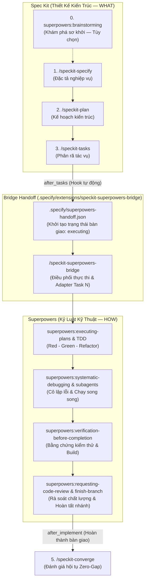

# DataSphere — .NET 10 WPF Modern Database Management System — AI Agent Guidance & Orchestration (`AGENTS.md`)

Tài liệu này là **bản đồ điều phối tối cao (Master Orchestration Guide)** dành cho AI Agent (Antigravity, Claude, Codex, Gemini CLI) khi làm việc trên kho mã nguồn **DataSphere**. Mọi hoạt động phát triển, kiểm thử, tái cấu trúc và kiểm toán mã nguồn đều phải tuân thủ nghiêm ngặt kiến trúc desktop hiện đại trên Windows (.NET 10 WPF + `Wpf.Ui`), phương pháp luận **Spec-Driven Development (Spec-Kit)** kết hợp kỷ luật kỹ thuật **Superpowers** qua cầu nối **`speckit-superpowers-bridge`**, tích hợp khả năng dịch ngược và phân tích nhị phân **REA (Reverse Engineer Anything)**, cùng các chuẩn mực chất lượng cấp độ **Tier-1 Enterprise**.

---

## 1. Tổng Quan Kiến Trúc Hệ Thống (Architecture Topology)

DataSphere là ứng dụng quản lý và truy vấn cơ sở dữ liệu (MySQL, MariaDB...) hiệu năng cao, hiện đại trên nền tảng Windows desktop:

### 1.1 Phân Hệ Khách Hàng Giao Diện (Presentation Layer)
- **Công nghệ cốt lõi**: .NET 10 (`net10.0-windows7.0`), C# (LangVersion `preview`), Windows Presentation Foundation (WPF).
- **Thư viện UI chính**: `Wpf.Ui` mang trải nghiệm Fluent Design 2 (Mica/Acrylic, modern controls, Snackbar, ContentDialog, System Theme Sync).
- **Mô hình kiến trúc**: **Clean MVVM** phân lớp nghiêm ngặt, sử dụng thư viện chuẩn ngành `CommunityToolkit.Mvvm`:
  - **Views** (`Views/Pages/`, `Views/Windows/`, `Dialogs/Views/`): Khai báo giao diện thuần XAML, không chứa logic nghiệp vụ (No Code-Behind Business Logic).
  - **ViewModels** (`ViewModels/Pages/`, `ViewModels/Windows/`): Điều khiển luồng nghiệp vụ, sử dụng source generators (`[ObservableProperty]`, `[RelayCommand]`), độc lập với các kiểu trực quan của WPF.
  - **Controls & Helpers** (`Controls/`, `Helpers/`): Custom controls, behaviors, and converters (`PreferNotNullConverter`, etc.).

### 1.2 Phân Hệ Dịch Vụ Nền Tảng & DI (Application Services & Host)
- **Generic Host & Dependency Injection**: Vận hành trên nền `Microsoft.Extensions.Hosting` (`IHost`, `IServiceCollection`), đăng ký vòng đời Services rõ ràng (Singleton / Transient / HostedService).
- **Dịch vụ điều phối chính**:
  - `ApplicationHostService`: Khởi tạo và quản lý vòng đời ứng dụng, điều hướng cửa sổ chính (`INavigationWindow`).
  - `NavigationService`: Quản trị chuyển trang mượt mà giữa các phân hệ (Connections, Database Objects, Query Editor, Settings).
  - `ThemeService` & `ApplicationThemeManager`: Đồng bộ theme hệ thống (Dark/Light/High Contrast) tức thời.
  - `MessengerService`: Trao đổi thông điệp bất đồng bộ, decoupled giữa các thành phần qua `WeakReferenceMessenger`.
  - `ConnectionStorageService` & `PasswordEncryptor`: Quản lý lưu trữ kết nối an toàn với cơ chế mã hóa mật khẩu bảo vệ dữ liệu người dùng.
- **Tiến trình đơn (Single Instance IPC)**: `Bootstrap.cs` sử dụng `Global\DataSphere.SingleInstance.App` (Windows Mutex + Named Pipe Server) để đảm bảo chỉ có một instance hoạt động, tự động kích hoạt cửa sổ khi người dùng mở lại app.

### 1.3 Phân Hệ Kết Nối Cơ Sở Dữ Liệu (Database Engine)
- **Thư viện kết nối**: `MySqlConnector` tối ưu hóa bất đồng bộ không phong tỏa luồng UI.
- Hỗ trợ quản lý phiên kết nối, kiểm tra tính khả dụng (Ping/Test Connection), thực thi truy vấn an toàn và phân trang dữ liệu.

---

## 2. Bất Biến Ranh Giới & Hiến Chương Dự Án (`CONSTITUTION.md`)

Mọi đề xuất mã nguồn hoặc thay đổi kiến trúc **bắt buộc tuân thủ 100%** Hiến chương dự án v1.5.0 ([`.specify/memory/constitution.md`](file:///d:/DEV/C%23DOTNET/DataSphere/.specify/memory/constitution.md)):

1. **Principle I: Clean MVVM & Type Safety**:
   - Sử dụng triệt để `CommunityToolkit.Mvvm` (`[ObservableProperty]`, `[RelayCommand]`).
   - ViewModels hoàn toàn UI-agnostic; cấm phụ thuộc trực tiếp vào visual tree (`FrameworkElement`, `Window`).
   - UI thread synchronization bắt buộc đi qua `Application.Current.Dispatcher`.
   - Cấm code-behind chứa logic nghiệp vụ.
2. **Principle II: Modern Fluent UI / UX Standards**:
   - Giao diện Fluent Design 2 qua `Wpf.Ui`, hỗ trợ Dark/Light Theme hoàn hảo.
   - Sử dụng `IContentDialogService` và `ISnackbarService` thay vì MessageBox Win32 chặn tiến trình.
3. **Principle III: Secure Database Connection & Credential Protection**:
   - Mật khẩu kết nối luôn được mã hóa (`PasswordEncryptor`) trước khi lưu trữ; không ghi mật khẩu vào log/dump.
   - Truy vấn SQL phải dùng parameterized query chống SQL Injection.
4. **Principle IV: High Performance & Thread Stewardship**:
   - Mọi I/O kết nối database và query chạy bất đồng bộ (`async`/`await`, `Task.Run`). Khung hình UI duy trì 60 FPS (<16ms).
   - Mọi tác vụ async dài hạn bắt buộc hỗ trợ `CancellationToken`.
   - Giải phóng tài nguyên database và recordset kịp thời (`using`, `IAsyncDisposable`).
5. **Principle V: English Technical Documentation Standard**:
   - 100% các lớp, giao diện, phương thức, thuộc tính và RelayCommands phải có XML Doc Comments (`/// <summary>`, `<param>`, `<returns>`) bằng Tiếng Anh chuẩn kỹ thuật.
6. **Principle VI: Spec-Driven Development & Superpowers Discipline**:
   - Mọi tính năng hay sửa lỗi tuân thủ quy trình Spec-Kit kết hợp Superpowers qua `speckit-superpowers-bridge`.
7. **Principle VII: Zero Hardcoded User-Facing Strings & Dynamic Internationalization (i18n)**:
   - Nghiêm cấm tuyệt đối hardcode chuỗi ký tự hiển thị người dùng (tiêu đề tab, tên card, thông báo lỗi, menu...) trong C# và XAML. Toàn bộ text UI bắt buộc dùng `TranslationSource` (`DataSphere.Utils.Translations`) và tài nguyên `.resx` (`String.resx`, `String.en.resx`, `String.vi.resx`) để hỗ trợ chuyển đổi ngôn ngữ động ngay khi người dùng chọn trong Cài đặt mà không cần khởi động lại ứng dụng.
   - Trong XAML, toàn bộ text hiển thị bắt buộc bind trực tiếp qua: `Text="{Binding [KeyName], Source={StaticResource Localization}, Mode=OneWay}"` thay vì khai báo các thuộc tính string dư thừa trên ViewModel.
   - **Mã hóa file tài nguyên**: Tất cả file `.resx` bắt buộc lưu ở định dạng **UTF-8 without BOM**. Tuyệt đối không dùng shell script appending để tránh lỗi hỏng font (Mojibake).
   - **Tách biệt TabView và Viewport**: Trong WinUI 3, `TabView` chỉ chứa header/items; cấm đặt trực tiếp `<ContentControl>` bên trong `<TabView>` (bắt buộc tách ra dòng Grid riêng biệt).
8. **Principle VIII: Visual UI Reproduction, Diagnostic Inspection & Verification Gate**:
   - **Tái hiện chẩn đoán khi báo lỗi (Diagnostic Reproduction Gate)**: Khi người dùng báo lỗi liên quan đến UI/UX, nghiêm cấm suy đoán nguyên nhân qua đọc code thuần túy. Bắt buộc khởi chạy app và thực thi kiểm thử UI Automation để tự động tái hiện lỗi thực tế, kiểm tra cây UI Automation element và chụp ảnh lỗi làm bằng chứng chẩn đoán trực tiếp vào tài liệu thẩm định lỗi (`assess.md`).
   - **Giao thức Desktop Station thực (`WinSta0\default`)**: Môi trường subshell agent mặc định nằm trong `WinSta0\exebox-...`. Để tương tác với desktop thật của người dùng và chụp ảnh màn hình chính xác, agent bắt buộc:
     1. Khởi chạy app qua Win32 `CreateProcess` với `STARTUPINFO.lpDesktop = @"WinSta0\default"`.
     2. Đổi desktop của thread kiểm thử qua `OpenDesktop("default", ...)` và `SetThreadDesktop(hDesk)`.
   - **Bảo toàn XAML sạch (Zero-AutomationId Invariant)**: Nghiêm cấm tuyệt đối thêm các thuộc tính kiểm thử tạm thời như `AutomationProperties.AutomationId` vào tệp XAML sản phẩm. Mọi định vị điều khiển tự động bắt buộc dựa vào:
     1. Hình học bố cục (`BoundingRectangle` x, y, width, height).
     2. Phân cấp điều khiển (`ControlType`: `Button`, `ComboBox`, `Text`).
     3. Khớp chuỗi ký tự hiển thị con từ tệp tài nguyên (`TextBlock.Name`).
   - **Điều khiển chuột vật lý & Chụp ảnh DirectComposition chuẩn**: Tính toán tọa độ tâm của control `(X, Y) = (rect.X + rect.Width / 2, rect.Y + rect.Height / 2)`, di chuyển chuột bằng `SetCursorPos(X, Y)`, kích hoạt click thật bằng `mouse_event`, và chụp ảnh cửa sổ WinUI 3 qua `PrintWindow` với cờ `PW_RENDERFULLCONTENT` (`flag = 2`).
   - **Tập lệnh mẫu chuẩn hóa (Standard Execution Blueprint)**: Tái sử dụng trực tiếp kịch bản mẫu đã kiểm chứng tại [`scripts/test-real-desktop.ps1`](file:///d:/DEV/C%23DOTNET/DataSphere/scripts/test-real-desktop.ps1) và [`scripts/verify-real-end-to-end.ps1`](file:///d:/DEV/C%23DOTNET/DataSphere/scripts/verify-real-end-to-end.ps1). Nghiêm cấm agent tương lai tự tìm hiểu lại từ đầu.
   - **Nghiêm cấm tuyệt đối suy đoán & Bắt buộc kiểm thử UI thực tế trước khi bàn giao (Zero-Speculation Live UI Verification Gate)**:
     - Nghiêm cấm tuyệt đối việc suy đoán, giả định, hoặc tuyên bố kiểu *"tôi đoán là nó hoạt động"*, *"về lý thuyết đã xong"*, hay *"chắc chắn đã fix"*.
     - Mọi tính năng giao diện, tương tác người dùng hoặc sửa lỗi UI/UX **CHỈ ĐƯỢC PHÉP BÀN GIAO** khi và chỉ khi đã chạy kịch bản kiểm thử tự động hóa thực tế trên desktop thật (`WinSta0\default`), thực hiện click chuột vật lý và tương tác chính xác (đúng tọa độ, đúng thao tác đóng/mở/chọn), chứng minh ứng dụng không bị crash và thu thập đầy đủ bằng chứng ảnh chụp màn hình DirectComposition (`PW_RENDERFULLCONTENT`) lưu vào thư mục artifacts (`<appDataDir>/brain/<conversation-id>`). Mọi nghiệm thu chỉ dựa trên `dotnet build` hoặc headless test khi có liên quan đến UI đều bị coi là vi phạm nghiêm trọng Hiến chương.

---

## 3. Phương Pháp Luận Phát Triển Dựa Trên Đặc Tả & Kỷ Luật Kỹ Thuật (Spec-Kit + Superpowers SDD Workflow)

Mọi tính năng mới, tái cấu trúc (refactoring) hoặc sửa lỗi (bug fixing) trên repository bắt buộc vận hành theo chu trình kết hợp **Spec-Driven Development (Spec-Kit)** và **Superpowers Engineering Discipline** thông qua cầu nối **`speckit-superpowers-bridge`**:
- **Spec Kit định nghĩa "WHAT"**: Đóng vai trò là nguồn chân lý thiết kế duy nhất (`constitution.md` ➔ `spec.md` ➔ `plan.md` ➔ `tasks.md`).
- **Superpowers thực thi "HOW"**: Thực thi kỷ luật kỹ thuật khắt khe (TDD Red-Green-Refactor, Systematic Debugging, Subagents song song, Verification, Code Review).
- **Bridge chuyển giao (Handoff Layer)**: Tự động kết nối hai hệ thống qua hook `after_tasks`, ghi nhận `.specify/superpowers-handoff.json`, kích hoạt bảo vệ chống trôi hợp đồng (Guard), và chuyển đổi các tác vụ `tasks.md` sang adapter `Task N` tương thích với Superpowers.



### Các Lệnh Slash Spec-Kit & Bridge Tiêu Chuẩn:
- **/speckit-specify**: Soạn thảo đặc tả kỹ thuật (`spec.md`) từ yêu cầu người dùng.
- **/speckit-plan**: Lập kế hoạch kiến trúc chi tiết (`plan.md`), nghiên cứu và mô hình hóa dữ liệu.
- **/speckit-tasks**: Tự động sinh danh sách tác vụ tuần tự (`tasks.md`).
- **/speckit-superpowers-bridge**: Điều phối thực thi các tác vụ `tasks.md` thông qua bộ kỹ năng Superpowers.
- **/speckit-implement**: Thực thi trực tiếp qua Spec Kit (được bảo vệ bởi Bridge Guard).
- **/speckit-converge**: Đánh giá hội tụ giữa mã nguồn thực tế và tài liệu đặc tả (Zero-Gap Gate).
- **/speckit-clarify**, **/speckit-checklist**, **/speckit-analyze**, **/speckit-constitution**: Các công cụ nâng cao chất lượng đặc tả.
- **/speckit-bug-assess**, **/speckit-bug-fix**, **/speckit-bug-test**: Quy trình xử lý lỗi phần mềm theo tiêu chuẩn.
- **/speckit-assess-intake**, **/speckit-assess-research**, **/speckit-assess-define**, **/speckit-assess-shape**, **/speckit-assess-decide**: Pipeline thẩm định ý tưởng trước khi lập spec.

---

## 4. Bản Đồ Quy Tắc Bắt Buộc (Rule Routing Matrix)

Thư mục [`.agents/rules/`](rules) chứa các quy tắc chuẩn mực bắt buộc áp dụng khi viết mã:

| Nhóm Quy Tắc | Tệp Quy Tắc | Phạm Vi Áp Dụng |
|---|---|---|
| **Tài Liệu Hóa Mã Nguồn** | [`code-documentation-english.md`](rules/code-documentation-english.md) | Toàn bộ codebase (100% US English XML Doc Comments) |
| **Bảo Vệ Dữ Liệu Nhạy Cảm** | [`obs-no-sensitive-data.md`](rules/obs-no-sensitive-data.md) | Toàn bộ codebase (Không lộ secret/token/connection credentials) |
| **Định Dạng Mã Nguồn** | [`editorconfig-compliance.md`](rules/editorconfig-compliance.md) | Toàn bộ mã C#, XAML, project files |
| **Đa Ngôn Ngữ & i18n** | [`i18n-localization.md`](rules/i18n-localization.md) | Toàn bộ mã C#, XAML (Nghiêm cấm hardcoded user-facing strings) |

---

## 5. Danh Mục Kỹ Năng Điều Phối (Skill Catalog Routing Matrix)

Hệ sinh thái kỹ năng tinh gọn trong [`.agents/skills/`](skills) gồm 50 kỹ năng được tổ chức thành 6 nhóm nghiệp vụ chính:

### 5.1. Kỹ Năng Điều Phối Phát Triển (Spec-Kit SDD — `github/spec-kit`)
- **`speckit-specify`**: Soạn thảo đặc tả kỹ thuật chuẩn hóa.
- **`speckit-plan`**: Lập kế hoạch kiến trúc và hợp đồng dữ liệu.
- **`speckit-tasks`**: Sinh danh sách tác vụ hành động tuần tự.
- **`speckit-implement`**: Điều phối thực thi tác vụ trực tiếp.
- **`speckit-converge`**: Đánh giá sự hội tụ và nghiệm thu tính năng.
- **`speckit-clarify`**, **`speckit-checklist`**, **`speckit-analyze`**, **`speckit-constitution`**: Các công cụ hỗ trợ chất lượng đặc tả.
- **`speckit-bug-assess`**, **`speckit-bug-fix`**, **`speckit-bug-test`**: Quy trình đánh giá và xử lý lỗi phần mềm.
- **`speckit-assess-intake`**, **`speckit-assess-research`**, **`speckit-assess-define`**, **`speckit-assess-shape`**, **`speckit-assess-decide`**: Bộ công cụ đánh giá ý tưởng và tính khả thi.
- **`speckit-taskstoissues`**: Chuyển đổi tác vụ thành các GitHub Issues có thứ tự phụ thuộc.

### 5.2. Kỹ Năng Cầu Nối Đặc Tả & Thực Thi (`speckit-superpowers-bridge`)
- **`speckit-superpowers-bridge`**: Cầu nối điều phối trung tâm giữa Spec Kit (`tasks.md`) và Superpowers (`executing-plans`, TDD, verification, review). Tạo adapter `Task N` dùng một lần từ `tasks.md`, tự động cập nhật checkbox và chuyển giao trạng thái hoàn thành.
- **`speckit-speckit-superpowers-bridge-guard`**: Ranh giới bảo vệ, ngăn sửa đổi hợp đồng kiến trúc Spec Kit khi đang thực thi và chặn lệnh implement thô.
- **`speckit-speckit-superpowers-bridge-handoff`**: Khởi tạo và ghi nhận trạng thái bàn giao tại `.specify/superpowers-handoff.json` ngay sau khi sinh tác vụ.
- **`speckit-speckit-superpowers-bridge-execute`**: Lệnh thực thi chính thống của cầu nối Superpowers.

### 5.3. Kỹ Năng Kỷ Luật Kỹ Thuật Superpowers (`obra/superpowers`)
- **`using-superpowers`**: Kỹ năng gốc thiết lập quy trình làm việc kỷ luật cho agent ngay từ đầu phiên làm việc.
- **`brainstorming`**: Khám phá ý tưởng, kiến trúc sơ khởi trước khi tạo spec.
- **`writing-plans`** & **`executing-plans`**: Lập và thực thi kế hoạch chi tiết từng bước, kiểm soát sai lệch nghiêm ngặt.
- **`test-driven-development`**: Kỷ luật TDD Red-Green-Refactor. Bắt buộc viết bài test fail trước khi viết code logic.
- **`systematic-debugging`**: Quy trình điều tra lỗi có hệ thống, cô lập nguyên nhân gốc rễ (RCA) trước khi đề xuất bản vá.
- **`subagent-driven-development`** & **`dispatching-parallel-agents`**: Phân rã tác vụ độc lập cho subagents chạy song song và review chéo kết quả.
- **`verification-before-completion`**: Bắt buộc thu thập bằng chứng kiểm thử thực tế (build 0 error, test pass) trước khi tuyên bố hoàn thành.
- **`requesting-code-review`** & **`receiving-code-review`**: Rà soát chất lượng mã nguồn đa chiều, giải quyết phản hồi với tiêu chuẩn kỹ thuật cao.
- **`using-git-worktrees`** & **`finishing-a-development-branch`**: Quản lý không gian làm việc git worktrees cô lập và đóng gói/dọn dẹp nhánh sạch sẽ.
- **`writing-skills`** & **`diagnosing-superpowers`**: Quản trị, viết mới và chẩn đoán hiệu quả kỹ năng của AI Agent.

### 5.4. Kỹ Năng Dịch Ngược & Kiểm Toán An Ninh Nhị Phân (`morluto/rea`)
- **`reverse-engineer-anything`**: Kỹ năng điều phối trung tâm cho REA MCP, phân tích tệp nhị phân native/managed (.NET PE, assemblies, dlls), phục hồi cấu trúc mã nguồn và hành vi runtime.
- **`authorized-artifact-auditor`**: Phân tích và phục hồi mã nguồn, kiểm toán an ninh và cấu trúc tệp nhị phân/artifacts được ủy quyền.
- **`security-audit`**: Khung kiểm toán an ninh bảo mật desktop, Named Pipes IPC, và phân quyền Windows.
- **`license-robustness-audit`**: Đánh giá độ bền vững và an toàn của cơ chế bản quyền phần mềm.
- **`vm-and-bytecode-reverse`**: Dịch ngược máy ảo và bytecode tùy biến.
- **`sbom-supply-chain-auditor`**: Kiểm toán SBOM chuỗi cung ứng, rà soát manifests/lockfiles và rủi ro giấy phép.

### 5.5. Kỹ Năng Giao Diện WPF, WinUI & Modern .NET
- **`mvvm-toolkit`**: Cốt lõi CommunityToolkit.Mvvm (source generators `[ObservableProperty]`, `[RelayCommand]`, base classes, commands, validation).
- **`mvvm-toolkit-di`**: Cấu hình Dependency Injection cho ViewModels và Services với Microsoft.Extensions.DependencyInjection.
- **`mvvm-toolkit-messenger`**: Giao tiếp decoupled giữa các ViewModels qua WeakReferenceMessenger pub/sub.
- **`winui-wpf-migration`**: Tham chiếu chuyển đổi và chuẩn hóa cấu trúc giữa WPF và WinUI 3.
- **`winui-code-review`**: Rà soát chất lượng code XAML/C# (Clean MVVM, compiled binding, memory leak, UI thread).
- **`winui-design`**: Thiết kế giao diện Fluent Design 2, brushes, icons, và khả năng tiếp cận (Accessibility).

### 5.6. Quản Trị Hệ Sinh Thái Kỹ Năng
- **`skill-creator`**: Hướng dẫn thiết kế, chuẩn hóa và tối ưu hóa kỹ năng cho AI Agent.

---

## 6. Quy Trình Kiểm Thử & Kiểm Định (Verification Workflow)

Trước khi nghiệm thu bất kỳ phiên làm việc, bản vá hoặc đề xuất commit nào, Agent bắt buộc phải chạy các bước kiểm thử tương ứng:

### 1. Biên Dịch Dự Án C# (.NET 10 WPF):
```powershell
dotnet build DataSphere\DataSphere.csproj -c Debug
```
*(Yêu cầu: 0 Error)*

### 2. Kiểm Tra Tiêu Chuẩn Chú Thích Kỹ Thuật (English Code Documentation):
Mọi lớp (classes), giao diện (interfaces), hàm, phương thức (methods), thuộc tính (properties) và RelayCommands đều bắt buộc phải có doc comments đầy đủ bằng Tiếng Anh chuẩn kỹ thuật tiêu chuẩn của ngành (`/// <summary>`, `<param>`, `<returns>`). Nghiêm cấm chấp thuận mã nguồn thiếu chú thích hoặc có chú thích không phải Tiếng Anh chuẩn.

### 3. Kiểm Tra Trạng Thái Cầu Nối Bridge:
```powershell
powershell -ExecutionPolicy Bypass -File .\.specify\extensions\speckit-superpowers-bridge\scripts\powershell\bridge-status.ps1 -Readiness
```
*(Yêu cầu: Readiness PASS)*

### 4. Tái Hiện Lỗi & Kiểm Thử Trực Quan UI (Diagnostic Reproduction & Visual Evidence Gates):
Mọi báo cáo lỗi hoặc tính năng giao diện người dùng bắt buộc phải được kiểm định thực tế qua UI Automation trên Desktop thực (`WinSta0\default`):
- **Kịch bản tự động hóa chuẩn**: Sử dụng mẫu chuẩn tại [`scripts/test-real-desktop.ps1`](file:///d:/DEV/C%23DOTNET/DataSphere/scripts/test-real-desktop.ps1) (khởi chạy trên `WinSta0\default`, đổi Desktop thread, điều khiển chuột vật lý, không thêm `AutomationId` vào XAML, chụp ảnh `PW_RENDERFULLCONTENT`).
- **Khi tiếp nhận lỗi (Bug Assessment Phase — `/speckit-bug-assess`)**: Bắt buộc khởi chạy ứng dụng thực tế để tái hiện lỗi, trích xuất cấu trúc element tree và chụp ảnh lỗi làm bằng chứng chẩn đoán trực tiếp vào tài liệu thẩm định lỗi (`assess.md`).
- **Khi nghiệm thu hoàn thành (Verification Gate — `/speckit-bug-test`, `/speckit-converge`)**: Bắt buộc khởi chạy ứng dụng sau khi sửa mã nguồn, chụp ảnh màn hình giao diện đã khắc phục, lưu vào thư mục artifacts và nhúng vào báo cáo nghiệm thu (`test.md`).
*(Yêu cầu: Không suy đoán lỗi trên lý thuyết, không làm bẩn XAML với AutomationId, giao diện hiển thị đúng layout, không bị trống nội dung, không vỡ font/Mojibake)*
