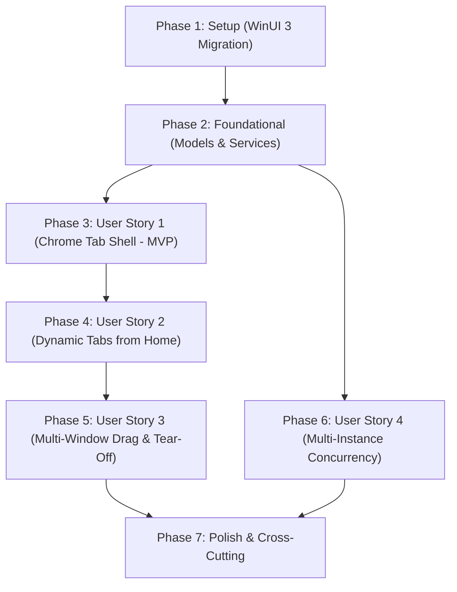

# Implementation Tasks: WinUI 3 Modern Tabbed Shell & Multi-Window Navigation

**Feature**: `001-winui3-chrome-tabs` | **Date**: 2026-10-19 | **Spec**: [spec.md](spec.md) | **Plan**: [plan.md](plan.md)

---

## Phase 1: Setup (Project Configuration & WinUI 3 Conversion)

**Purpose**: Project initialization, toolchain migration from WPF to Windows App SDK, and dependency cleanup

- [ ] T001 Convert `DataSphere/DataSphere.csproj` to target `net10.0-windows10.0.19041.0` with Windows App SDK 1.6+ and WinUI 3 dependencies
- [ ] T002 Remove legacy WPF references (`Wpf.Ui`, `Wpf.Ui.Tray`, `System.Windows.*`) from `DataSphere/DataSphere.csproj`
- [ ] T003 [P] Update `DataSphere/app.manifest` for Windows App SDK unpackaged desktop execution compatibility

---

## Phase 2: Foundational (Models, Contracts & Core Services)

**Purpose**: Core models, service interfaces, and window management infrastructure that MUST be completed before UI story implementation

**⚠️ CRITICAL**: No user story work can begin until this phase is complete

- [ ] T004 [P] Create `TabLifecycleState` enum in `DataSphere/Models/TabLifecycleState.cs`
- [ ] T005 [P] Create `TabItemModel` in `DataSphere/Models/TabItemModel.cs` with `Id`, `Title`, `IconGlyph`, `PageType`, `Content`, `IsClosable`, `IsSelected`, and `State`
- [ ] T006 [P] Create `WindowSession` model in `DataSphere/Models/WindowSession.cs` tracking `WindowId`, `WindowInstance`, `Tabs`, and `SelectedTab`
- [ ] T007 [P] Create `TabDragPayload` model in `DataSphere/Models/TabDragPayload.cs` holding `SourceWindowId`, `TabId`, `Tab`, and `SourceIndex`
- [ ] T008 [P] Define `ITabService` interface in `DataSphere/Services/Contracts/ITabService.cs` per contract specification
- [ ] T009 [P] Define `IWindowManager` interface in `DataSphere/Services/Contracts/IWindowManager.cs` per contract specification
- [ ] T010 Implement `TabService` in `DataSphere/Services/TabService.cs` implementing tab collection management and selection
- [ ] T011 Implement `WindowManager` in `DataSphere/Services/WindowManager.cs` tracking active `WindowSession`s and window lifecycle
- [ ] T012 Configure dependency injection services in `DataSphere/App.xaml.cs` to register `IWindowManager` as Singleton and tab factories

**Checkpoint**: Foundation ready — User Story 1 implementation can now proceed

---

## Phase 3: User Story 1 - Browser-Style Chrome Tab Strip & Sidebar Navigation Removal (Priority: P1) 🎯 MVP

**Goal**: Deliver a modern browser-style Chrome tab strip integrated into the window titlebar with the uncloseable Home dashboard, completely retiring the vertical sidebar navigation

**Independent Test**: Launch DataSphere; verify the top header displays the tab strip with the uncloseable "Home" tab displaying existing dashboard cards, window caption controls remain on the top right, and the left vertical `NavigationView` is completely removed.

### Implementation for User Story 1

- [ ] T013 [US1] Create `ShellViewModel` in `DataSphere/ViewModels/Windows/ShellViewModel.cs` bound to `ITabService.Tabs` and `SelectedTab`
- [ ] T014 [US1] Create `ShellWindow.xaml` and `ShellWindow.xaml.cs` in `DataSphere/Views/Windows/ShellWindow.xaml` with native `TabView` embedded into titlebar via `ExtendsContentIntoTitleBar="True"`
- [ ] T015 [US1] Anchor the uncloseable `Home` tab at index 0 with `IsClosable="False"` in `DataSphere/ViewModels/Windows/ShellViewModel.cs`
- [ ] T016 [US1] Remove legacy `MainWindow.xaml` and `MainWindow.xaml.cs` containing `ui:NavigationView` in `DataSphere/Views/Windows/`
- [ ] T017 [US1] Update `DataSphere/Services/ApplicationHostService.cs` to instantiate and activate `ShellWindow` as the primary application window

**Checkpoint**: User Story 1 (MVP) is fully functional and testable independently

---

## Phase 4: User Story 2 - Dynamic Page Tab Opening from Home Dashboard (Priority: P1)

**Goal**: Enable dynamic creation and management of closable tabs for "Cơ sở dữ liệu" (Database) and "Cài Đặt" (Settings) directly from Home dashboard card clicks

**Independent Test**: On the Home tab, click the "Cài Đặt" card to open a closable Settings tab, switch between Home and Settings, and click the close button (`X`) on the Settings tab to dismiss it and return focus to Home.

### Implementation for User Story 2

- [ ] T018 [P] [US2] Migrate `HomePage.xaml` and `HomePage.xaml.cs` (formerly `DashboardPage`) in `DataSphere/Views/Pages/HomePage.xaml` to WinUI 3 controls
- [ ] T019 [US2] Update `HomeViewModel.cs` in `DataSphere/ViewModels/Pages/HomeViewModel.cs` to dispatch tab opening messages for "Cơ sở dữ liệu" and "Cài Đặt"
- [ ] T020 [P] [US2] Migrate `SettingsPage.xaml` and `SettingsPage.xaml.cs` in `DataSphere/Views/Pages/SettingsPage.xaml` to WinUI 3 XAML controls
- [ ] T021 [P] [US2] Migrate `DatabasePage.xaml` and `DatabasePage.xaml.cs` in `DataSphere/Views/Pages/DatabasePage.xaml` to WinUI 3 XAML controls
- [ ] T022 [US2] Implement dynamic tab opening in `DataSphere/Services/TabService.cs` to instantiate pages and add closable tabs (`IsClosable="True"`)
- [ ] T023 [US2] Implement `TabCloseRequested` event handler in `DataSphere/Views/Windows/ShellWindow.xaml.cs` to cleanly remove content tabs and shift focus

**Checkpoint**: User Stories 1 and 2 are fully integrated and testable together

---

## Phase 5: User Story 3 - Multi-Window Tab Drag & Drop, Tear-Off & Docking (Priority: P2)

**Goal**: Provide fluid multi-window tab management, allowing users to drag tabs out into new windows, dock tabs between windows, and automatically close donor windows when only 2 tabs exist

**Independent Test**: Drag the "Cơ sở dữ liệu" tab outside Window 1 to spawn Window 2. Verify Window 1 closes automatically if it only had 2 tabs (Home + Cơ sở dữ liệu). Drag "Cơ sở dữ liệu" from Window 2 back to another window and confirm Window 2 automatically closes.

### Implementation for User Story 3

- [ ] T024 [US3] Configure `CanDragTabs="True"` and `CanReorderTabs="True"` on `TabView` in `DataSphere/Views/Windows/ShellWindow.xaml`
- [ ] T025 [US3] Implement `TabDragStarting` in `DataSphere/Views/Windows/ShellWindow.xaml.cs` to package `TabDragPayload` and cancel dragging on the Home tab
- [ ] T026 [US3] Implement `TabDroppedOutside` in `DataSphere/Views/Windows/ShellWindow.xaml.cs` to call `IWindowManager.TearOffTabToNewWindow` and spawn a new `ShellWindow` at cursor coordinates
- [ ] T027 [US3] Implement `TabStripDragOver` and `TabStripDrop` in `DataSphere/Views/Windows/ShellWindow.xaml.cs` to handle cross-window tab docking
- [ ] T028 [US3] Implement donor window auto-closure rule in `DataSphere/Services/WindowManager.cs` when content is transferred out of a 2-tab window leaving only Home

**Checkpoint**: Full multi-window drag-and-drop tear-off and cross-window docking operational

---

## Phase 6: User Story 4 - Multi-Instance Concurrency (Priority: P2)

**Goal**: Permit multiple independent DataSphere processes to launch simultaneously from the operating system without single-instance mutex rejection

**Independent Test**: Launch two separate DataSphere processes from the terminal or Start Menu; verify both instances open independent windows and operate concurrently without process collision.

### Implementation for User Story 4

- [ ] T029 [US4] Remove the blocking single-instance mutex enforcement in `DataSphere/Bootstrap.cs` to enable multi-process concurrency
- [ ] T030 [US4] Update named pipe / IPC registration in `DataSphere/Bootstrap.cs` to use unique per-process session identifiers preventing pipe conflicts

**Checkpoint**: Multi-instance concurrency verified across independent OS processes

---

## Phase 7: Polish & Cross-Cutting Concerns

**Purpose**: Documentation compliance, cleanup of obsolete WPF artifacts, and end-to-end validation

- [ ] T031 [P] Add 100% US English XML doc comments on all new classes, interfaces, methods, and properties per Constitution Principle V
- [ ] T032 Clean up obsolete WPF controls, converters, and assets in `DataSphere/Controls/` and `DataSphere/Helpers/`
- [ ] T033 Execute end-to-end quickstart validation scenarios per `specs/001-winui3-chrome-tabs/quickstart.md`
- [ ] T034 Run `dotnet build DataSphere/DataSphere.csproj -c Debug` to verify clean compilation with 0 errors and 0 warnings

---

## Dependencies & Execution Order

### Phase Dependencies

### User Story Dependencies
- **User Story 1 (P1)**: Depends on Phase 1 & Phase 2. Core MVP.
- **User Story 2 (P1)**: Depends on User Story 1 shell layout.
- **User Story 3 (P2)**: Depends on User Story 2 dynamic tabs.
- **User Story 4 (P2)**: Depends on Phase 2, can be executed in parallel with Stories 1-3.

### Parallel Opportunities

- **Phase 1**: T003 can execute in parallel with T001/T002.
- **Phase 2**: Models T004, T005, T006, T007 and Contracts T008, T009 can all be implemented in parallel.
- **Phase 4**: Page migrations T018, T020, T021 can be implemented in parallel.
- **Phase 7**: T031 documentation and T032 cleanup can run in parallel before final build.

---

## Implementation Strategy

### MVP First (User Story 1 Only)
1. Complete Phase 1 (WinUI 3 conversion).
2. Complete Phase 2 (Core models and services).
3. Complete Phase 3 (User Story 1 — ShellWindow with TabView and uncloseable Home tab).
4. **VALIDATE MVP**: Verify application launches into the browser-style tab shell with no sidebar navigation.

### Incremental Delivery
1. Add User Story 2 → Test dynamic tab opening for Database and Settings from dashboard cards.
2. Add User Story 3 → Test tab tear-off to new window, re-docking, and 2-tab donor auto-closure.
3. Add User Story 4 → Test multi-process concurrency.
4. Execute Polish phase → Final documentation audit and zero-error build verification.
