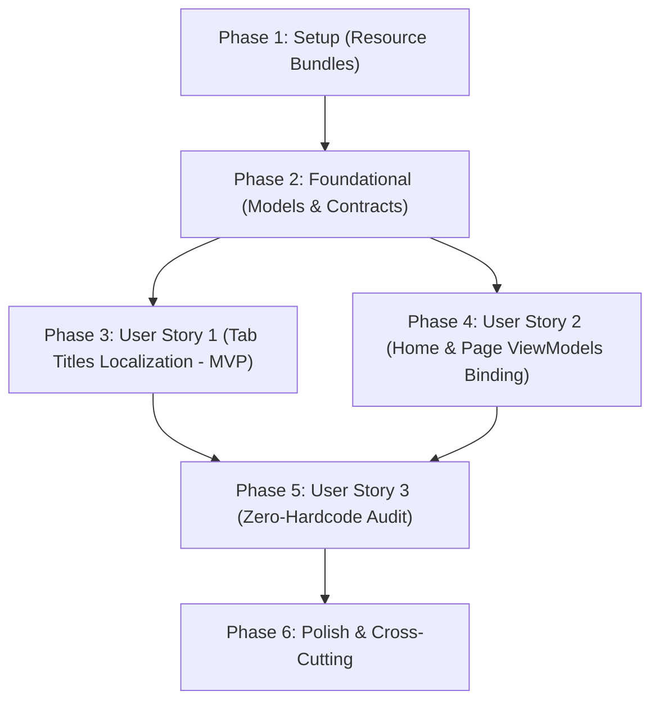

# Implementation Tasks: Dynamic Internationalization & Zero Hardcoded Strings (i18n)

**Feature**: `002-dynamic-i18n-localization` | **Date**: 2026-10-19 | **Spec**: [spec.md](spec.md) | **Plan**: [plan.md](plan.md)

---

## Phase 1: Setup (Resource Files Audit & Symmetry)

**Purpose**: Resource bundle synchronization, symmetric translation keys, and culture fallback handling

- [x] T001 Audit and synchronize all existing localization keys across `DataSphere/Resources/Locales/String.resx`, `DataSphere/Resources/Locales/String.en.resx`, and `DataSphere/Resources/Locales/String.vi.resx`
- [x] T002 [P] Add missing dashboard and section keys (`page_home_sections_title`, `page_home_banner_title`, `page_home_banner_desc`, `page_home_card_database_desc`, `page_home_card_settings_desc`) to all three `.resx` files
- [x] T003 [P] Enhance `LanguageBase.GetLangValue` in `DataSphere/Utils/Translations.cs` with graceful fallback to invariant/English culture when a key is missing for the active culture

---

## Phase 2: Foundational (Core Models & Service Contracts)

**Purpose**: Core model extensions and service contract updates required before user story implementation

**⚠️ CRITICAL**: No user story work can begin until this phase is complete

- [x] T004 [P] Add `TitleKey` property to `TabItemModel` in `DataSphere/Models/TabItemModel.cs` and wire `TranslationSource.Instance.PropertyChanged` to automatically re-evaluate `Title` when culture changes
- [x] T005 Define updated `ITabService` contract in `DataSphere/Services/Contracts/ITabService.cs` accepting `titleKey` in `OpenTab`
- [x] T006 Implement updated `OpenTab` in `DataSphere/Services/TabService.cs` resolving initial `Title` via `LanguageBase.GetLangValue(titleKey)` and tracking `TitleKey` on the model

**Checkpoint**: Foundation ready — User Story 1 and User Story 2 can now proceed

---

## Phase 3: User Story 1 - Dynamic Tab Titles & Window Tab Strip Localization (Priority: P1) 🎯 MVP

**Goal**: Enable real-time dynamic localization for all tab headers across all windows without recreating tabs or losing active page state

**Independent Test**: Launch DataSphere with Vietnamese default; verify Home tab reads "Trang chủ". Open Database and Settings tabs; switch language to English in Settings; verify all open tab headers update immediately to "Home", "Databases", and "Settings" in < 100ms.

### Implementation for User Story 1

- [x] T007 [US1] Update `ShellViewModel.InitializeHomeTab` in `DataSphere/ViewModels/Windows/ShellViewModel.cs` to pass `titleKey = "page_home_title"` for the anchored Home tab
- [x] T008 [US1] Update `HomeViewModel.OpenDatabase` and `HomeViewModel.OpenSettings` in `DataSphere/ViewModels/Pages/HomeViewModel.cs` to invoke `_tabService.OpenTab` with resource keys (`"page_db_title"`, `"page_settings_title"`) instead of hardcoded strings
- [x] T009 [US1] Verify and update multi-window tab transfer in `DataSphere/Services/WindowManager.cs` to preserve `TitleKey` when tearing off or docking tabs across windows

**Checkpoint**: User Story 1 (MVP) is fully functional and independently testable

---

## Phase 4: User Story 2 - Home Dashboard & Page ViewModels Dynamic String Binding (Priority: P1)

**Goal**: Eradicate all hardcoded text literals in `HomePage`, `DatabasePage`, and their ViewModels, binding all UI elements dynamically to `TranslationSource`

**Independent Test**: Navigate to Home dashboard; verify section headers, action card titles, and description text match active language. Switch language in Settings and return to Home; verify 100% of text on Home and Database pages dynamically refreshed.

### Implementation for User Story 2

- [x] T010 [P] [US2] Update `HomeViewModel.cs` in `DataSphere/ViewModels/Pages/HomeViewModel.cs` to add bindable localized properties (`SectionsTitle`, `DatabaseCardTitle`, `DatabaseCardSummary`, `SettingsCardTitle`, `SettingsCardSummary`) observing `TranslationSource.Instance.PropertyChanged`
- [x] T011 [US2] Update `HomePage.xaml` in `DataSphere/Views/Pages/HomePage.xaml` to replace all hardcoded text literals with `{x:Bind ViewModel.<Property>, Mode=OneWay}`
- [x] T012 [P] [US2] Update `DatabaseViewModel.cs` in `DataSphere/ViewModels/Pages/DatabaseGroup/DatabaseViewModel.cs` to dynamically initialize and update `Title` from `page_db_title` via `TranslationSource.Instance.PropertyChanged`
- [x] T013 [US2] Update `DatabasePage.xaml` in `DataSphere/Views/Pages/DatabaseGroup/DatabasePage.xaml` to bind the header to `ViewModel.Title`
- [x] T014 [P] [US2] Audit and eliminate any remaining hardcoded strings in `SettingsPage.xaml` and `SettingsViewModel.cs`

**Checkpoint**: User Stories 1 and 2 are fully integrated; all user-facing shell and page strings are 100% dynamic

---

## Phase 5: User Story 3 - Centralized Localization Resources & Zero-Hardcode Verification (Priority: P2)

**Goal**: Validate full key coverage across all three resource bundles and verify zero hardcoded UI strings remain in presentation code

**Independent Test**: Execute automated regex/string scan across all `*.cs` and `*.xaml` files; confirm 0 occurrences of prohibited hardcoded UI text literals.

### Implementation for User Story 3

- [x] T015 [US3] Perform automated codebase audit searching for prohibited UI string literals in C# ViewModels, Models, and XAML views outside resource files
- [x] T016 [US3] Verify graceful fallback behavior in `Translations.cs` when an invalid or unknown key is requested

**Checkpoint**: 100% compliance with Constitution Principle VII verified

---

## Phase 6: Polish & Cross-Cutting Concerns

**Purpose**: Documentation compliance, end-to-end quickstart validation, and clean build verification

- [x] T017 [P] Verify 100% US English XML doc comments on all new and modified classes, methods, and properties per Constitution Principle V
- [x] T018 Execute end-to-end quickstart validation scenarios per `specs/002-dynamic-i18n-localization/quickstart.md`
- [x] T019 Run `dotnet build DataSphere\DataSphere.csproj -c Debug` to verify clean compilation with 0 errors and 0 warnings

---

## Dependencies & Execution Order

### Phase Dependencies

### User Story Dependencies

- **User Story 1 (P1)**: Depends on Phase 1 (Resources) & Phase 2 (Contracts). Core MVP.
- **User Story 2 (P1)**: Depends on Phase 1 & Phase 2. Can be developed in parallel with US1.
- **User Story 3 (P2)**: Depends on US1 and US2 completion to audit all migrated components.

### Parallel Opportunities

- **Phase 1**: T002 and T003 can execute in parallel.
- **Phase 2**: T004 (`TabItemModel`) and T005 (`ITabService`) can be implemented in parallel.
- **Phase 4**: T010 (`HomeViewModel`), T012 (`DatabaseViewModel`), and T014 (`SettingsViewModel`) can be implemented in parallel.
- **Phase 6**: T017 documentation audit and T018 quickstart run can proceed before T019 final build.

---

## Implementation Strategy

### MVP First (User Story 1 Only)
1. Complete Phase 1 (Resource synchronization).
2. Complete Phase 2 (Core models and contracts with `TitleKey`).
3. Complete Phase 3 (User Story 1 — Localized tab headers for Home, Database, Settings).
4. **VALIDATE MVP**: Verify tab headers translate instantly when changing language in Settings.

### Incremental Delivery
1. Add User Story 2 → Replace all hardcoded strings on `HomePage.xaml`, `DatabasePage.xaml`, and ViewModels.
2. Add User Story 3 → Audit codebase for zero remaining hardcoded UI strings.
3. Execute Polish phase → Documentation verification and clean build with 0 errors and 0 warnings.
