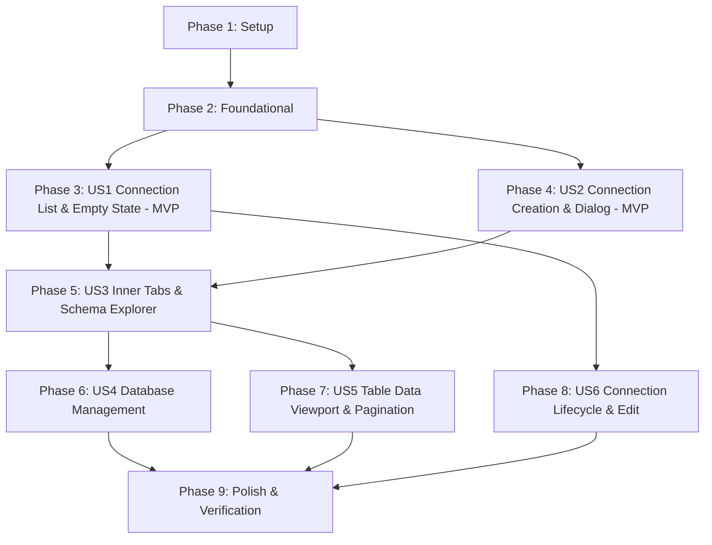

# Tasks: Database Connection Management & Selection

**Feature**: `004-database-connection-management`  
**Input**: Design documents from [`specs/004-database-connection-management/`](.)  
**Prerequisites**: [`plan.md`](plan.md), [`spec.md`](spec.md), [`research.md`](research.md), [`data-model.md`](data-model.md), [`contracts/`](contracts/)  

## Format: `- [ ] [TaskID] [P?] [Story?] Description with file path`
- **[P]**: Parallelizable task (independent files, no blocking prerequisites)
- **[Story]**: User story identifier mapping to `spec.md` (e.g. `[US1]`, `[US2]`, etc.)

---

## Phase 1: Setup (Shared Infrastructure & Localization)

**Purpose**: Core string bundles, models, and shared types required across all database features.

- [ ] T001 [P] Add database connection, test status, pagination, and dialog localization keys to `DataSphere/Resources/Locales/String.resx`
- [ ] T002 [P] Add English translations for all new keys to `DataSphere/Resources/Locales/String.en.resx`
- [ ] T003 [P] Add Vietnamese translations for all new keys to `DataSphere/Resources/Locales/String.vi.resx`
- [ ] T004 [P] Create `InnerTabItemModel` supporting Header, IconGlyph, Content, IsClosable, ConnectionKey, and IDisposable context in `DataSphere/Models/InnerTabItemModel.cs`
- [ ] T005 [P] Create `TableDataPage` and `TableRowData` models for paginated tabular data in `DataSphere/Models/TableDataPage.cs`

---

## Phase 2: Foundational (Blocking Prerequisites)

**Purpose**: Credential security, encrypted storage, and WinUI 3 dialog infrastructure.

**⚠️ CRITICAL**: Must complete before user stories to ensure safe credential handling and dialog hosting.

- [ ] T006 Implement transparent AES-CBC password encryption on SaveAsync and decryption on LoadAsync in `DataSphere/Services/ConnectionStorageService.cs`
- [ ] T007 [P] Create `IDialogService` interface for presenting WinUI 3 ContentDialogs with explicit XamlRoot in `DataSphere/Services/Contracts/IDialogService.cs`
- [ ] T008 Implement `DialogService` resolving active window XamlRoot via `IWindowManager` in `DataSphere/Services/DialogService.cs`
- [ ] T009 Register `IDialogService` and `DialogService` in dependency injection container in `DataSphere/App.xaml.cs`
- [ ] T010 Add headless unit tests in `scratch/VerifyUserDataStore/Program.cs` verifying encrypted `connections.json` persistence and round-trip decryption

**Checkpoint**: Foundation ready — secure storage and dialog coordination operational.

---

## Phase 3: User Story 1 - Database Connection List & Empty State Presentation (Priority: P1) 🎯 MVP

**Goal**: Display configured database connections in a hierarchical tree view, or an informative empty state view with a "New Connection" action button when zero connections exist.

**Independent Test**: Launch DataSphere and navigate to Database tab. Verify clean empty-state view when no connections exist in `connections.json`. When connections exist, verify tree renders connection name, engine icon (`\uE774`), host, port, and contextual commands.

### Implementation for User Story 1

- [ ] T011 [US1] Implement `ConnectControlViewModel` managing `ConnectItems`, empty state visibility flags, folder creation, and connection collection changes in `DataSphere/ViewModels/Pages/DatabaseGroup/ConnectControlViewModel.cs`
- [ ] T012 [US1] Create `ConnectViewControl.xaml` implementing connection `TreeView`, context menus (Add Connection, Add Folder), and styled empty-state banner in `DataSphere/Views/Pages/DatabaseGroup/ConnectViewControl.xaml`
- [ ] T013 [US1] Implement code-behind for tree item double-click and key navigation in `DataSphere/Views/Pages/DatabaseGroup/ConnectViewControl.xaml.cs`
- [ ] T014 [US1] Refactor `DatabaseViewModel` to host inner tabs collection with Tab 0 anchored to `ConnectViewControl` in `DataSphere/ViewModels/Pages/DatabaseGroup/DatabaseViewModel.cs`
- [ ] T015 [US1] Update `DatabasePage.xaml` to embed inner WinUI 3 `TabView` binding to `DatabaseViewModel.InnerTabs` in `DataSphere/Views/Pages/DatabaseGroup/DatabasePage.xaml`
- [ ] T016 [US1] Update `DatabasePage.xaml.cs` code-behind to support inner tab selection and initialization in `DataSphere/Views/Pages/DatabaseGroup/DatabasePage.xaml.cs`

**Checkpoint**: User Story 1 complete — users can view connection catalog and empty state.

---

## Phase 4: User Story 2 - Creating & Configuring New Database Connections (Priority: P1) 🎯 MVP

**Goal**: Allow users to configure new database server parameters (Name, Host, Port, Username, Password, Database) and test connectivity asynchronously inside a native WinUI 3 `ContentDialog` before saving.

**Independent Test**: Click "New Connection". Enter `127.0.0.1`, port `3306`, user `root`. Click "Test Connection"; confirm non-blocking execution (<5s) with success badge or descriptive error. Click "Save"; verify immediate tree addition and encrypted persistence in `connections.json`.

### Implementation for User Story 2

- [ ] T017 [P] [US2] Create `ConnectionEditingViewModel` with validation for mandatory fields (Name, Host, User not empty) and async `TestConnectionCommand` in `DataSphere/ViewModels/Dialogs/ConnectionEditingViewModel.cs`
- [ ] T018 [US2] Implement native WinUI 3 `ConnectionEditingDialog.xaml` with themed layout, input fields, test connection button, progress indicator, and status badge in `DataSphere/Views/Dialogs/ConnectionEditingDialog.xaml`
- [ ] T019 [US2] Implement `ConnectionEditingDialog.xaml.cs` code-behind with data context binding and result extraction in `DataSphere/Views/Dialogs/ConnectionEditingDialog.xaml.cs`
- [ ] T020 [US2] Wire `ShowConnectionEditingDialogAsync` in `DataSphere/Services/DialogService.cs` to present dialog with assigned `XamlRoot`
- [ ] T021 [US2] Connect "New Connection" buttons in `ConnectControlViewModel` and `ConnectViewControl` to open `ConnectionEditingDialog` and persist newly created connection to disk

**Checkpoint**: User Story 2 complete — users can test, create, and safely save encrypted database connections.

---

## Phase 5: User Story 3 - Connecting, Disconnecting & Schema Discovery in Inner Tabs (Priority: P2)

**Goal**: Double-clicking or clicking "Connect" on a saved connection establishes an asynchronous session, creates a dedicated inner closable tab, and loads the hierarchical schema tree (Databases, Tables, Views, Functions, Procedures).

**Independent Test**: Connect to a server. Confirm a new inner tab opens with connection name. Verify tree displays database schemas and categories. Disconnect or close tab; verify connection is disposed.

### Implementation for User Story 3

- [ ] T022 [US3] Implement `DatabaseControlViewModel` managing connection session, schema retrieval via `IDatabaseConnection.GetAllDatabasesAsync()`, and category trees in `DataSphere/ViewModels/Pages/DatabaseGroup/DatabaseControlViewModel.cs`
- [ ] T023 [US3] Create `DatabaseViewControl.xaml` with split-panel layout: left schema `TreeView`, draggable `GridSplitter`, and right content viewport in `DataSphere/Views/Pages/DatabaseGroup/DatabaseViewControl.xaml`
- [ ] T024 [US3] Implement `DatabaseViewControl.xaml.cs` handling node expansion, lazy table loading, and right-panel disposal in `DataSphere/Views/Pages/DatabaseGroup/DatabaseViewControl.xaml.cs`
- [ ] T025 [US3] Wire connection tab creation in `DatabaseViewModel.cs` when `startConnectionCallback` is triggered from `ConnectControlViewModel`
- [ ] T026 [US3] Implement `TabCloseRequested` handler on inner `TabView` in `DatabasePage.xaml.cs` to gracefully disconnect session and dispose `DatabaseControlViewModel`

**Checkpoint**: User Story 3 complete — multi-connection tabbed sessions and schema explorer fully functional.

---

## Phase 6: User Story 4 - Database Schema Management (Priority: P2)

**Goal**: Allow users to create, edit, and drop database schemas directly from the object explorer tree using native `ContentDialog` prompts.

**Independent Test**: Right-click server node, select "New Database", enter name and collation, confirm creation. Right-click database, select "Drop Database", confirm prompt; verify schema is dropped from server and tree.

### Implementation for User Story 4

- [ ] T027 [P] [US4] Create `DatabaseEditingViewModel` managing database name, character set, and collation selection in `DataSphere/ViewModels/Dialogs/DatabaseEditingViewModel.cs`
- [ ] T028 [US4] Implement native WinUI 3 `DatabaseEditingDialog.xaml` and code-behind in `DataSphere/Views/Dialogs/DatabaseEditingDialog.xaml` and `DataSphere/Views/Dialogs/DatabaseEditingDialog.xaml.cs`
- [ ] T029 [US4] Implement `ShowDatabaseEditingDialogAsync` and confirmation dialog in `DataSphere/Services/DialogService.cs`
- [ ] T030 [US4] Implement `CreateDatabase` and `DropDatabase` commands with confirmation dialogs in `DataSphere/ViewModels/Pages/DatabaseGroup/DatabaseControlViewModel.cs`

**Checkpoint**: User Story 4 complete — database schema creation and drop management working.

---

## Phase 7: User Story 5 - Table Data Viewport & Pagination (Priority: P2)

**Goal**: Selecting a table in the schema tree displays its rows in a paginated, virtualized data viewport with column metadata, page limit selector (100, 500, 1000), navigation buttons, and Refresh command.

**Independent Test**: Select a table with 10,000+ rows. Verify first page of 100 rows loads in <500ms without freezing UI. Switch page size to 500; verify page count recalculates and records reload. Click Next page and Refresh; verify correct page offsets are queried.

### Implementation for User Story 5

- [ ] T031 [P] [US5] Implement `GetTableDataPageAsync` with parameterized `LIMIT @Limit OFFSET @Offset` query in `DataSphere/Services/Database/Connection/MySqlDatabaseConnection.cs`
- [ ] T032 [US5] Implement `DataControlViewModel` managing active page, page size, total record count, column definitions, and refresh in `DataSphere/ViewModels/Pages/DatabaseGroup/DataControlViewModel.cs`
- [ ] T033 [US5] Implement `DataViewControl.xaml` featuring dynamic column headers, virtualized `ListView` for cells, and bottom pagination bar in `DataSphere/Views/Pages/DatabaseGroup/DataViewControl.xaml`
- [ ] T034 [US5] Implement `DataViewControl.xaml.cs` with disposal cleanup in `DataSphere/Views/Pages/DatabaseGroup/DataViewControl.xaml.cs`
- [ ] T035 [US5] Connect table selection in `DatabaseControlViewModel` to instantiate `DataViewControl` in the right panel

**Checkpoint**: User Story 5 complete — high-performance paginated table browsing operational.

---

## Phase 8: User Story 6 - Editing, Renaming & Deleting Connections (Priority: P2)

**Goal**: Allow editing existing connection parameters, inline renaming of connections/folders, and deleting obsolete connections with confirmation.

**Independent Test**: Right-click connection, select "Edit", change port, save and verify persistence. Rename inline with Enter. Right-click connection, select "Delete", confirm dialog; verify removal from tree and `connections.json`.

### Implementation for User Story 6

- [ ] T036 [US6] Wire "Edit Connection" context menu command in `ConnectControlViewModel` to open `ConnectionEditingDialog` pre-populated with decrypted credentials
- [ ] T037 [US6] Implement inline renaming logic with blur/Enter key handlers in `ConnectViewControl.xaml` and `ConnectControlViewModel.cs`
- [ ] T038 [US6] Implement connection deletion with confirmation dialog prompt and file persistence in `DataSphere/ViewModels/Pages/DatabaseGroup/ConnectControlViewModel.cs`

**Checkpoint**: User Story 6 complete — full lifecycle management of connection catalog.

---

## Phase 9: Polish & Cross-Cutting Concerns

**Purpose**: Verification gates, XML documentation, internationalization audit, and zero-gap assurance.

- [ ] T039 [P] Perform 100% US English XML doc comment audit (`/// 
`, `<param>`, `<returns>`) across all newly created and modified files
- [ ] T040 Verify dynamic i18n switching between English and Vietnamese across all database views and dialogs without restart
- [ ] T041 Run headless verification suite in `scratch/VerifyUserDataStore/Program.cs` verifying 0 test failures
- [ ] T042 Execute full build verification (`dotnet build DataSphere\DataSphere.csproj -c Debug`) ensuring 0 errors and 0 warnings

---

## Dependencies & Execution Order

### Phase Dependencies

### Parallel Opportunities

- **Phase 1 Setup**: Tasks `T001`, `T002`, `T003`, `T004`, `T005` can all be executed in parallel.
- **Phase 2 Foundational**: Tasks `T007` and `T008` can be developed in parallel with `T006`.
- **Phase 4 US2 Dialog**: Task `T017` (ViewModel) can be created in parallel with `T018` (XAML layout).
- **Phase 6 US4 Schema**: Task `T027` (ViewModel) can run in parallel with `T028` (Dialog XAML).
- **Phase 7 US5 Table Viewport**: Task `T031` (Data Connection query) can run in parallel with `T032` (ViewModel).
- **Phase 9 Polish**: Tasks `T039` and `T040` can run in parallel before final build validation.

---

## Implementation Strategy

### MVP Scope (Phases 1, 2, 3 & 4)
- Delivers the connection tree, empty state, connection creation dialog, async test connection, and encrypted storage.
- Immediate value: Users can open the Database tab, see their connections (or create one), test server access, and save configurations securely.

### Incremental Delivery (Phases 5, 6, 7 & 8)
- **Increment 2 (US3)**: Opens connection in dedicated inner tabs with full schema tree.
- **Increment 3 (US4)**: Adds database creation and drop capabilities.
- **Increment 4 (US5)**: Adds paginated table browsing in the right panel.
- **Increment 5 (US6)**: Adds edit, rename, and delete lifecycle commands.
- **Increment 6 (Polish)**: Finalizes documentation, translations, and passes all constitutional quality gates.
