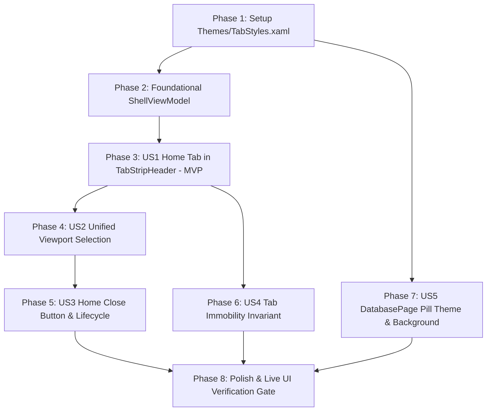

# Tasks: Home Tab in TabStripHeader and Unified Tab Styling

**Input**: Design documents from `/specs/013-home-tab-tabstripheader/`
**Prerequisites**: [plan.md](./plan.md) (required), [spec.md](./spec.md) (required), [data-model.md](./data-model.md), [contracts/tabstripheader-home-contract.md](./contracts/tabstripheader-home-contract.md), [quickstart.md](./quickstart.md)

## Format: `- [ ] [ID] [P?] [Story?] Description with file path`

- **[P]**: Can run in parallel (different files, no dependencies)
- **[Story]**: Which user story this task belongs to ([US1], [US2], [US3], [US4], [US5])
- All paths are relative to repository root (`DataSphere/`)

---

## Phase 1: Setup (Shared Theme Infrastructure)

**Purpose**: Extract reusable tab styles into a dedicated theme dictionary accessible across the application.

- [ ] T001 Extract `PillTabViewItemStyle` and TabView override tokens from `DataSphere/Views/Windows/ShellWindow.xaml` into new resource dictionary `DataSphere/Themes/TabStyles.xaml`
- [ ] T002 Merge `Themes/TabStyles.xaml` into `DataSphere/App.xaml` within `ResourceDictionary.MergedDictionaries`

---

## Phase 2: Foundational (ViewModel State & Data Modeling)

**Purpose**: Core state management for decoupled Home tab and dynamic workspace tabs.

- [ ] T003 Decouple `HomeTab` from dynamic `Tabs` collection in `DataSphere/ViewModels/Windows/ShellViewModel.cs`, introducing `IsHomeSelected`, `ActiveViewportContent`, `SelectHomeCommand`, and `CloseHomeCommand`
- [ ] T004 Implement collection change monitoring in `DataSphere/ViewModels/Windows/ShellViewModel.cs` to dynamically toggle `HomeTab.IsClosable` (`true` when `Tabs.Count == 0`, `false` when `Tabs.Count >= 1`)

---

## Phase 3: User Story 1 - Home Tab Anchored in TabStripHeader (Priority: P1) 🎯 MVP

**Goal**: Host the Home tab permanently inside `TabView.TabStripHeader` to the left of the dynamic tab strip with pill capsule visual styling.

**Independent Test**: Launch application on real desktop (`WinSta0\default`), confirm Home tab appears inside `TabStripHeader` with pill geometry (`CornerRadius="8"`), icon `\uE80F`, and title "Home".

- [ ] T005 [US1] Remove inline `PillTabViewItemStyle` definition from `DataSphere/Views/Windows/ShellWindow.xaml` and reference `{StaticResource PillTabViewItemStyle}` from `Themes/TabStyles.xaml`
- [ ] T006 [US1] Update `TabView.TabStripHeader` in `DataSphere/Views/Windows/ShellWindow.xaml` to host `CustomDragRegionLeft` and a `TabViewItem` styled with `PillTabViewItemStyle` bound to `ViewModel.HomeTab`
- [ ] T007 [US1] Update `DataSphere/Views/Windows/ShellWindow.xaml.cs` to synchronize session tabs exclusively with dynamic tabs in `ViewModel.Tabs` (excluding Home)

**Checkpoint**: At this point, the Home tab is visually anchored in `TabStripHeader` and dynamic tabs render to its right.

---

## Phase 4: User Story 2 - Seamless Selection & Unified Viewport Navigation (Priority: P2)

**Goal**: Coordinate mutual exclusion between Home selection and dynamic tab selection, rendering active content in the decoupled central viewport.

**Independent Test**: Open a dynamic tab, alternate clicking between Home and the dynamic tab, and verify that the central `ContentPresenter` instantly swaps between `HomePage` and the dynamic page.

- [ ] T008 [US2] Update `DataSphere/Views/Windows/ShellWindow.xaml` to bind central `ContentPresenter.Content` to `{x:Bind ViewModel.ActiveViewportContent, Mode=OneWay}`
- [ ] T009 [US2] Wire `Tapped="OnHomeTabTapped"` and `SelectionChanged="OnTabViewSelectionChanged"` in `DataSphere/Views/Windows/ShellWindow.xaml.cs` to coordinate mutual selection between `HomeTab` and `ShellTabView`
- [ ] T010 [US2] Implement automatic fallback selection to `HomeTab` when the last remaining dynamic tab is closed in `DataSphere/ViewModels/Windows/ShellViewModel.cs`

**Checkpoint**: Selection smoothly alternates between Home and dynamic tabs with zero viewport orphaning.

---

## Phase 5: User Story 3 - Home Close Button Visibility & Window Shutdown Lifecycle (Priority: P3)

**Goal**: Display close button on Home tab only when Home is the sole open tab, and clean application shutdown upon closing Home.

**Independent Test**: Verify close button ('X') on Home is visible when `Tabs.Count == 0`, clicking it exits the application; verify 'X' is hidden when `Tabs.Count >= 1`.

- [ ] T011 [US3] Implement `CloseHomeCommand` in `DataSphere/ViewModels/Windows/ShellViewModel.cs` to invoke `RequestCloseWindow` event only when `HomeTab.IsClosable == true` and `Tabs.Count == 0`
- [ ] T012 [US3] Wire `CloseRequested="OnHomeTabCloseRequested"` in `DataSphere/Views/Windows/ShellWindow.xaml.cs` to execute `ViewModel.CloseHomeCommand`

**Checkpoint**: Home close button visibility strictly reflects tab count (sole tab = closable; multiple tabs = unclosable).

---

## Phase 6: User Story 4 - Tab Immobility & Drag Protection for Anchored Home (Priority: P4)

**Goal**: Prohibit any dragging, reordering, or tear-off operations on the Home tab.

**Independent Test**: Attempt mouse drag on Home tab; verify tab does not move, no drag payload is generated, and dynamic tabs reorder freely around it.

- [ ] T013 [US4] Enforce drag-prevention checks in `OnTabDragStarting` within `DataSphere/Views/Windows/ShellWindow.xaml.cs` ensuring only items from `ViewModel.Tabs` can initiate dragging

**Checkpoint**: Home tab is permanently fixed in `TabStripHeader` and immune to drag/drop events.

---

## Phase 7: User Story 5 - Reusable Pill Tab Theme in Database Workspace (Priority: P5)

**Goal**: Apply `PillTabViewItemStyle` to `InnerTabView` in `DatabasePage.xaml` with a uniform container background matching the tab surface.

**Independent Test**: Open `DatabasePage`, verify inner table/query tabs render with pill capsule styling and the background behind the tab bar and content area displays a unified `LayerFillColorDefaultBrush`.

- [ ] T014 [US5] Update `InnerTabView` in `DataSphere/Views/Pages/DatabaseGroup/DatabasePage.xaml` to apply `Style="{StaticResource PillTabViewItemStyle}"` on its `TabViewItem`
- [ ] T015 [US5] Configure `Background="{ThemeResource LayerFillColorDefaultBrush}"` on the Grid container in `DataSphere/Views/Pages/DatabaseGroup/DatabasePage.xaml` enclosing `InnerTabView` and active tab `ContentControl`

**Checkpoint**: `DatabasePage` features unified pill styling and cohesive card background.

---

## Phase 8: Polish & Cross-Cutting Concerns

**Purpose**: Validation, technical documentation, and quality gate adherence.

- [ ] T016 [P] Verify 100% technical US English XML documentation comments on all newly introduced/modified methods, properties, and RelayCommands in `DataSphere/ViewModels/Windows/ShellViewModel.cs` per Principle V
- [ ] T017 [P] Verify dynamic localization on Home tab title (`page_home_title`) using `TranslationSource` across English and Vietnamese per Principle VII
- [ ] T018 Execute automated UI testing on real desktop (`WinSta0\default`) verifying all scenarios from `quickstart.md`, capturing DirectComposition screenshot evidence into artifact directory per Principle VIII

---

## Dependencies & Execution Order

### Phase Dependencies

- **Setup (Phase 1)**: No dependencies — executes immediately.
- **Foundational (Phase 2)**: Depends on Phase 1 completion — blocks all user stories.
- **User Story 1 (Phase 3)**: Depends on Phase 2 — delivers MVP.
- **User Story 2 (Phase 4)**: Depends on US1 completion.
- **User Story 3 (Phase 5)**: Depends on US1 and US2 completion.
- **User Story 4 (Phase 6)**: Depends on US1 completion.
- **User Story 5 (Phase 7)**: Depends on Phase 1 (`Themes/TabStyles.xaml`).
- **Polish (Phase 8)**: Depends on all user stories being complete.

---

## Parallel Execution Opportunities

- `T001` (`Themes/TabStyles.xaml`) and `T003` (`ShellViewModel.cs`) can be authored in parallel.
- `T014` / `T015` (`DatabasePage.xaml`) can run in parallel with `ShellWindow.xaml` modifications once Phase 1 is merged.
- `T016` (XML Docs) and `T017` (i18n check) can run in parallel during Polish.

---

## Implementation Strategy

### MVP First (User Story 1)
1. Complete Phase 1: Setup (`Themes/TabStyles.xaml`).
2. Complete Phase 2: Foundational (`ShellViewModel.cs`).
3. Complete Phase 3: User Story 1 (`ShellWindow.xaml`).
4. Validate MVP: Home tab rendered in `TabStripHeader`.

### Incremental Delivery
1. Add US2: Seamless mutual selection between Home and dynamic tabs.
2. Add US3: Lifecycle close rules (close button appears only when Home is alone).
3. Add US4: Immobility verification.
4. Add US5: `DatabasePage` pill styling and uniform background.
5. Execute end-to-end live UI verification on `WinSta0\default` to satisfy Principle VIII.
