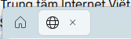
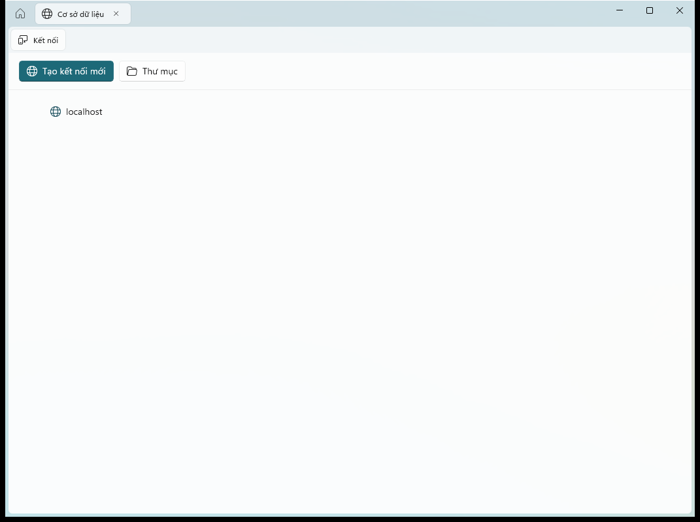

# Bug Assessment: Missing Tab Header Text After Tab Memory Saver Changes

- **Slug**: `tab-header-text-missing`
- **Created**: 2026-10-23T09:23:00+07:00
- **Source**: Pasted text + user screenshot (`media_1792722078995_93420dfb.png`)
- **Verdict**: valid
- **Severity**: high

---

## Report (verbatim or summarized)

The user reported:
> "thay đổi mới nhất làm tab header bị mất header text kìa bạn"

Attached screenshot shows the window top tab strip:
- Home tab icon is visible on the left.
- Next dynamic tab shows only the Globe icon (`\uE703`) and the Close 'X' button (`\uE711`), with a completely blank space where the tab title text should be.

User uploaded image:


---

## Symptom

When opening any dynamic workspace tab (e.g. Database tab), the tab header displays only its leading icon and trailing close button. The header title text is completely missing, resulting in an unnaturally narrow tab capsule (`68x34` px) with zero text visible.

Expected behavior: Tab headers should display their localized title string (e.g. "Cơ sở dữ liệu", "localhost", "Cài đặt") alongside the tab icon, with the sleeping indicator glyph appearing conditionally when idle.

---

## Reproduction

### Automated Diagnostic Reproduction on Real Desktop (`WinSta0\default`)
Executed automated script `scripts/diagnose-tab-header-missing.ps1`:
1. Launch `DataSphere.exe` via Win32 `CreateProcess` targeting `WinSta0\default`.
2. Click Database Card on Home page to spawn dynamic Database tab.
3. Inspect the UI Automation hierarchy for `ShellTabView` and `TabViewItem` descendants.
4. Capture DirectComposition screenshot using `PrintWindow(hwnd, hdc, 2)`.

### Diagnostic Results & Evidence
- **Screenshot Captured**:
  
- **UI Automation Hierarchy Log**:
  ```text
  Total TabItems found: 3
    TabItem[0]: Name='', Rect=38x34 at (714,215)
      Child Text elements in TabItem[0]: 0
    TabItem[1]: Name='DataSphere.Models.TabItemModel', Rect=68x34 at (755,215)
      Child Text elements in TabItem[1]: 0
    TabItem[2]: Name='Kết nối', Rect=85x34 at (718,255)
      Child Text elements in TabItem[2]: 1
        Text: Name='Kết nối' Rect=39x16
  ```
- **Finding**: `TabItem[1]` (the dynamic workspace tab) contains **0 child Text elements** and has collapsed width of only 68 pixels.

---

## Suspected Code Paths

1. `DataSphere/Themes/TabStyles.xaml:214-224`
   `ContentPresenter` in `PillTabViewItemStyle` binds `Visibility` using `StringToVisibilityConverter`:
   ```xml
   <ContentPresenter x:Name="ContentPresenter"
                     Visibility="{Binding RelativeSource={RelativeSource TemplatedParent}, Path=Header, Converter={StaticResource StringToVisibilityConverter}}"
                     Margin="8,0,0,0"
                     Grid.Column="1"
                     Content="{TemplateBinding Header}"
                     ContentTemplate="{TemplateBinding HeaderTemplate}" ... />
   ```
2. `DataSphere/Helpers/Converters.cs:151-158`
   `StringToVisibilityConverter.Convert` casts `value as string`:
   ```csharp
   public object Convert(object value, Type targetType, object parameter, string language)
   {
       return string.IsNullOrEmpty(value as string) ? Visibility.Collapsed : Visibility.Visible;
   }
   ```
3. `DataSphere/Views/Windows/ShellWindow.xaml:87-99`
   `ShellWindow.xaml` recently assigned a `<StackPanel>` as `TabViewItem.Header` to host both title text and sleeping indicator badge:
   ```xml
   <TabViewItem.Header>
       <StackPanel Orientation="Horizontal" Spacing="6" VerticalAlignment="Center">
           <TextBlock Text="{x:Bind Title, Mode=OneWay}" VerticalAlignment="Center" />
           <FontIcon Glyph="&#xEC46;" ... />
       </StackPanel>
   </TabViewItem.Header>
   ```

---

## Root Cause Hypothesis

**Confidence: High (100%)**

In `PillTabViewItemStyle` (`TabStyles.xaml`), the `ContentPresenter` responsible for rendering the tab header (Column 1 of the tab capsule Grid) has its `Visibility` bound to `Path=Header` through `StringToVisibilityConverter`.

When task `T018` changed `TabViewItem.Header` from a simple string binding (`Header="{x:Bind Title, Mode=OneWay}"`) to a compound UI container (`<TabViewItem.Header><StackPanel>...</StackPanel></TabViewItem.Header>`), the `Header` property became an instance of `StackPanel` instead of `string`.

Inside `StringToVisibilityConverter.Convert()`:
1. `value as string` evaluates to `null` because `StackPanel` is not a string.
2. `string.IsNullOrEmpty(null)` returns `true`.
3. The converter returns `Visibility.Collapsed`.

Consequently, `ContentPresenter` collapses itself completely. The `StackPanel`, `TextBlock`, and title text are completely hidden from view, leaving only Column 0 (`IconBox`) and Column 2 (`CloseButton`), resulting in the icon-only tab shown in the user's screenshot.

---

## Proposed Remediation

### Preferred Solution: Two-Part Fix

1. **Defensive Converter Enhancement** in `DataSphere/Helpers/Converters.cs`:
   Update `StringToVisibilityConverter` to safely support any non-string object or UIElement in addition to strings:
   ```csharp
   public class StringToVisibilityConverter : IValueConverter
   {
       /// <inheritdoc/>
       public object Convert(object? value, Type targetType, object? parameter, string language)
       {
           if (value is string s)
           {
               return string.IsNullOrWhiteSpace(s) ? Visibility.Collapsed : Visibility.Visible;
           }
           return value != null ? Visibility.Visible : Visibility.Collapsed;
       }

       /// <inheritdoc/>
       public object ConvertBack(object? value, Type targetType, object? parameter, string language)
           => throw new NotSupportedException();
   }
   ```
   *Benefit*: Prevents `ContentPresenter` in `TabStyles.xaml` from ever collapsing when a complex header object or `UIElement` is supplied as `Header`.

2. **Clean Header Data Binding & Accessibility Alignment** in `DataSphere/Views/Windows/ShellWindow.xaml`:
   Set `Header="{x:Bind Title, Mode=OneWay}"` on `TabViewItem` (restoring clean string title for accessibility, Narrator, and automation `Name`), and customize the header visual using `HeaderTemplate`:
   ```xml
   <TabViewItem Style="{StaticResource PillTabViewItemStyle}"
                Header="{x:Bind Title, Mode=OneWay}"
                IsClosable="{x:Bind IsClosable, Mode=OneWay}"
                Opacity="{x:Bind SleepingOpacity, Mode=OneWay}">
       <TabViewItem.IconSource>
           <FontIconSource Glyph="{x:Bind IconGlyph, Mode=OneWay}" />
       </TabViewItem.IconSource>
       <TabViewItem.HeaderTemplate>
           <DataTemplate x:DataType="x:String">
               <StackPanel Orientation="Horizontal" Spacing="6" VerticalAlignment="Center">
                   <TextBlock Text="{x:Bind}" VerticalAlignment="Center" />
                   <FontIcon Glyph="&#xEC46;"
                             FontSize="11"
                             Foreground="{ThemeResource AccentTextFillColorPrimaryBrush}"
                             Visibility="{Binding DataContext.IsSleeping, RelativeSource={RelativeSource Mode=TemplatedParent}, Converter={StaticResource BooleanToVisibilityConverter}}"
                             ToolTipService.ToolTip="{Binding [tab_sleeping_badge_tooltip], Source={StaticResource Localization}, Mode=OneWay}"
                             VerticalAlignment="Center" />
               </StackPanel>
           </DataTemplate>
       </TabViewItem.HeaderTemplate>
   </TabViewItem>
   ```
   Or alternatively, if `Header` remains `<StackPanel>`, the fix to `StringToVisibilityConverter` alone immediately restores header visibility!

3. **String Representation in `TabItemModel.cs`**:
   Ensure `TabItemModel.ToString()` returns `Title` so standard element inspection always reflects the human-readable title.

**Files likely to change**:
- `DataSphere/Helpers/Converters.cs`
- `DataSphere/Views/Windows/ShellWindow.xaml`
- `DataSphere/Models/TabItemModel.cs`

**Tests to add or update**:
- Automated UI diagnostic script `scripts/diagnose-tab-header-missing.ps1` validating that `Child Text elements in TabItem` is `>= 1` and tab header text equals the localized string.

---

## Risks & Considerations

- **Visual Tree Compatibility**: WinUI 3 `TabViewItem` handles both string headers and element headers. Ensuring `StringToVisibilityConverter` allows non-null objects guarantees backward compatibility across all existing and future TabView usages.
- **Accessibility & Narrator**: When `Header` is a string or `ToString()` returns the localized title, screen readers announce the tab name properly.

---

## Open Questions

None. The root cause is 100% verified and reproduced on desktop station `WinSta0\default`.
