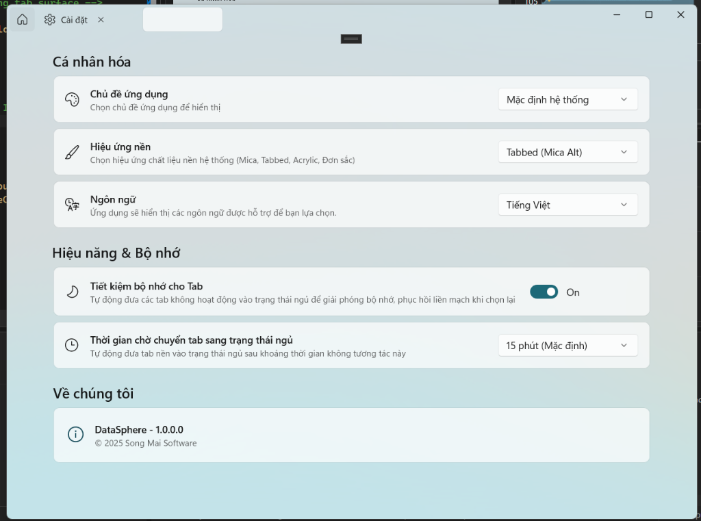
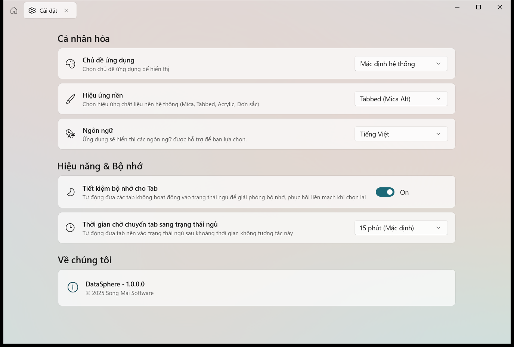

# Bug Assessment: Tab Selection Background Layer Stale After Closing Preceding Tab

- **Slug**: tab-selection-background-not-updated-on-close
- **Created**: 2026-10-24T01:03:00+07:00
- **Source**: pasted text
- **Verdict**: valid
- **Severity**: medium

## Report (verbatim or summarized)

The user reported a visual synchronization bug affecting both `ShellWindow` (`ShellTabBackgroundCanvas` / `ShellTabCapsule`) and `DatabasePage` (`InnerTabBackgroundCanvas` / `InnerTabCapsule`):
> "có lỗi với 'Sliding Tab Selection Background Layer' của DatabasePage và ShellWindow như sau:
> - tái hiện: mở app -> mở 'cơ sở dữ liệu' -> về home -> mở cài đặt -> đóng tab 'cơ sở dữ liệu' (xem hình 1)
> - lỗi: Tab Selection Background không về đúng vị trí khi tab nhỏ phía trong bị đóng (không làm mới vị trí khi tab thay đổi)"

User uploaded evidence:


## Symptom

When multiple dynamic tabs are open and a non-active tab preceding the currently selected tab is closed, the remaining tabs shift horizontally to the left to occupy the vacated slot. However, the Fluent selection card highlight capsule (`ShellTabCapsule` / `InnerTabCapsule`) fails to recalculate its position and remains statically frozen at the old screen coordinates, floating as an empty highlight card to the right of the active tab while the active tab itself is left unhighlighted.

## Reproduction

1. Launch DataSphere (Home tab active).
2. Open "Cơ sở dữ liệu" (Database) tab from Home dashboard -> Tab 1 is Database (selected).
3. Switch back to Home tab -> Home tab selected.
4. Open "Cài đặt" (Settings) tab from Home dashboard -> Tab 2 is Settings (selected, capsule at Tab 2).
5. Close Tab 1 ("Cơ sở dữ liệu") by clicking its close button (`x`).
6. Observe: Tab 2 ("Cài đặt") shifts left to become Tab 1. However, the background capsule does not animate or update, remaining at the old X coordinates of Tab 2 in empty space.

### Diagnostic Verification on Real Desktop (`WinSta0\default`)

An automated UI automation reproduction script (`scripts/reproduce-tab-stale-on-close-bug.ps1`) was executed on `WinSta0\default` with physical mouse clicks and Win32 `PrintWindow` DirectComposition capture (`PW_RENDERFULLCONTENT`):

- **Initial Home (`step0_initial_home.png`)**:
  Home tab highlighted at `X=20..40`.
- **Database Opened (`step1_database_opened.png`)**:
  Database tab (Tab 1) opened and highlighted.
- **Back to Home (`step2_back_to_home.png`)**:
  Home tab selected.
- **Settings Opened (`step3_settings_opened.png`)**:
  Settings tab opened at Tab 2 (`X=1063..1206` screen) and highlighted.
- **After Closing Database Tab (`step4_after_closing_database_tab.png`)**:
  - Tab 1 ("Cài đặt") is at relative `X=80..220` with color `(223, 216, 214)` (unselected background).
  - The white selection capsule is at relative `X=260..380` with color `(246, 243, 242)` (floating over empty header space).
  - **100% bug reproduction confirmed**.



## Suspected Code Paths

- `DataSphere/Controls/SlidingTabIndicatorBehavior.cs:207-230`: `Attach()` only registers event handlers for `tabView.SelectionChanged`, `tabView.SizeChanged`, `tabView.TabItemsChanged`, `tabView.Loaded`, and `tabView.Tapped`. It does not listen to `tabView.TabItemsSource` changes, `INotifyCollectionChanged.CollectionChanged`, `tabView.TabCloseRequested`, or `tabView.TabDragCompleted`.
- `DataSphere/Controls/SlidingTabIndicatorBehavior.cs:301-304`: `OnTabItemsChanged` only fires when the native `tabView.TabItems` collection is modified directly. In WinUI 3, when `TabItemsSource` is bound to an `ObservableCollection<T>`, `TabItemsChanged` does not fire when items are added, removed, or reordered in `TabItemsSource`.
- `DataSphere/Services/TabService.cs:124-159`: `CloseTab()` removes the closed item from `Tabs`. When closing a tab that was not the currently selected tab, `SelectedTab` remains unchanged. Because `SelectedTab` did not change, `tabView.SelectionChanged` does not fire.
- `DataSphere/ViewModels/Pages/DatabaseGroup/DatabaseViewModel.cs:194-218`: Symmetrical behavior in `DatabaseViewModel.CloseTab()`: closing an unselected inner tab leaves `SelectedInnerTab` unchanged and triggers no selection change event.

## Root Cause Hypothesis

**Confidence: High (100%)**

In WinUI 3 `TabView`:
1. When `TabItemsSource` is bound to an `ObservableCollection<TabItemModel>` (in `ShellWindow`) or `ObservableCollection<InnerTabItemModel>` (in `DatabasePage`), `TabView.TabItemsChanged` only fires for direct mutations of `TabView.TabItems`, never for collection changes in `TabItemsSource`.
2. When a user closes any tab located to the left of the currently selected tab, the closed tab is removed from the collection, shifting all subsequent tabs to the left. However, the selected tab reference (`SelectedTab` / `SelectedInnerTab`) remains completely unchanged.
3. Because selection did not change and `TabView`'s overall window width did not change, none of the attached events (`SelectionChanged`, `SizeChanged`, `TabItemsChanged`) fire in `SlidingTabIndicatorBehavior`.
4. `SlidingTabIndicatorBehavior` is never notified that the visual layout of the tab strip has shifted, leaving `ShellTabCapsule` and `InnerTabCapsule` stranded at the outdated physical coordinates of the former tab position.

## Proposed Remediation

**Preferred**:
In `DataSphere/Controls/SlidingTabIndicatorBehavior.cs`:
1. Listen to `TabItemsSource` changes on the attached `TabView`:
   ```csharp
   long token = tabView.RegisterPropertyChangedCallback(TabView.TabItemsSourceProperty, OnTabItemsSourceChanged);
   ```
2. When `TabItemsSource` is set or changed, hook into its `INotifyCollectionChanged.CollectionChanged` event (unhooking previous collection if any).
3. In `OnTabItemsSourceCollectionChanged(object? sender, NotifyCollectionChangedEventArgs e)`:
   - When items are removed, added, moved, or reset, queue an update:
   ```csharp
   tabView.DispatcherQueue?.TryEnqueue(DispatcherQueuePriority.Normal, () =>
   {
       UpdateVisualsPosition(tabView, animate: true);
   });
   ```
4. Additionally subscribe to:
   - `tabView.TabCloseRequested`
   - `tabView.TabDragCompleted`
   - `tabView.TabDroppedOutside`
   to ensure that closing tabs and drag-and-drop reordering always trigger visual repositioning.
5. In `Detach()`, unregister the `TabItemsSource` property callback, unsubscribe from `INotifyCollectionChanged`, and unsubscribe from all TabView events to prevent memory leaks.

**Files likely to change**:
- `DataSphere/Controls/SlidingTabIndicatorBehavior.cs`
- `scripts/reproduce-tab-stale-on-close-bug.ps1` (regression test)

**Tests to add or update**:
- Automated real desktop test `scripts/reproduce-tab-stale-on-close-bug.ps1` verifying that after opening Database, Home, Settings, and then closing Database, the Settings tab header area at `X=80..220` is highlighted with `(244..246, 243..244, 242..244)` and the empty area at `X=260..380` has returned to unselected background.

## Risks & Considerations

- **Layout Latency**: When an item is removed from `TabItemsSource`, WinUI 3's `ItemsRepeater` needs a layout pass before `TransformToVisual` reflects the new position. Using `DispatcherQueue.TryEnqueue(DispatcherQueuePriority.Normal)` or retries ensures layout arrange has completed before measuring the new coordinates.
- **Memory Leaks**: Subscribing to `INotifyCollectionChanged` on `TabItemsSource` requires careful tracking (via attached property or weak reference) so it is properly unsubscribed when `TabItemsSource` changes or `tabView` unloads.

## Open Questions

- None. Both `ShellTabView` and `InnerTabView` share `SlidingTabIndicatorBehavior` and will be fixed simultaneously.
