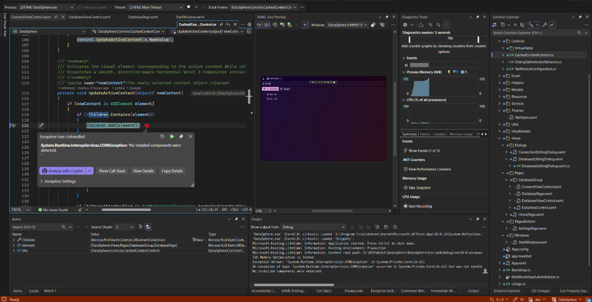

# Bug Assessment: Unhandled COMException (0x800F1000) When Tearing Off Tab to New Window

- **Slug**: tab-tearoff-new-window-crash
- **Created**: 2026-10-24T01:52:00+07:00
- **Source**: pasted text
- **Verdict**: valid
- **Severity**: high

## Report (verbatim or summarized)

The user reported an unhandled crash when dragging the "Databases" tab outside of the window to tear it off into a new window:
> "xem hình. tôi gặp lỗi khi tôi kéo tab databases ra cửa sổ mới"

User uploaded screenshot from Visual Studio debugger:


Debugger inspection from screenshot:
- **Exception**: `System.Runtime.InteropServices.COMException: 'No installed components were detected.'`
- **Location**: `DataSphere.Controls.CachedContentControl.UpdateActiveContent(object? newContent)` at line 121
- **Offending Line**: `Children.Add(element);`
- **Locals**:
  - `Children`: `Microsoft.UI.Xaml.Controls.UIElementCollection`
  - `element`: `{DataSphere.Views.Pages.DatabaseGroup.DatabasePage}`
  - `this`: `{DataSphere.Controls.CachedContentControl}` (belonging to the newly spawned `ShellWindow`)
- **Output / Event Log**: HRESULT `0x800F1000` (`SPAPI_E_ERROR_NOT_INSTALLED`, reused by WinUI 3 XAML core to signify an invalid visual tree parentage operation: element already has a parent container).

## Symptom

When a user drags an open document/page tab (e.g., "Databases") outside the bounds of the application window to tear it off into a new independent window, the application abruptly terminates with an unhandled `System.Runtime.InteropServices.COMException (0x800F1000)` inside `CachedContentControl.UpdateActiveContent` at `Children.Add(element)`.

## Reproduction

### Manual Reproduction Steps:
1. Launch DataSphere (`ShellWindow` opens with the default Home tab).
2. Open the "Cơ sở dữ liệu" (Databases) tab from the Home dashboard.
3. Click and hold the Databases tab in the title bar tab strip.
4. Drag the tab outside the window bounds into empty desktop space and release the mouse.
5. **Observed**: A new `ShellWindow` starts initializing, but crashes immediately with `COMException: 'No installed components were detected.'` at `CachedContentControl.UpdateActiveContent:121`.
6. **Expected**: The Databases tab detaches cleanly from the donor window and attaches into the newly created window's viewport without crashing.

### Diagnostic Verification on Real Desktop (`WinSta0\default`):
- Executed `scripts/reproduce-tab-tearoff-crash.ps1` on `WinSta0\default`:
  - Launched PID 9452.
  - Opened Databases tab.
  - Performed physical drag of Tab 1 upwards outside the window bounds.
  - Process 9452 crashed (`Windows count for process: 0`).
  - Windows Event Log confirmed APPCRASH:
    - Faulting module: `Microsoft.UI.Xaml.dll`
    - Exception code: `0xc000027b` (WinRT stowed exception)
    - Error code: `800f1000` (`SPAPI_E_ERROR_NOT_INSTALLED`).

## Suspected Code Paths

1. `DataSphere/Controls/CachedContentControl.cs:115-124`:
   ```csharp
   private void UpdateActiveContent(object? newContent)
   {
       if (newContent is UIElement element)
       {
           if (!Children.Contains(element))
           {
               Children.Add(element); // Throws COMException if element is already attached to another container
           }
   ```
   `Children.Add(element)` assumes that if `Children.Contains(element)` is false for `this` instance, the element is free to be added. It does not check whether `element` already belongs to another `Panel` (specifically the donor window's `CachedContentControl`).
2. `DataSphere/Views/Windows/ShellWindow.xaml.cs:238-270`:
   `OnTabDroppedOutside` removes `tabModel` from `ViewModel.Tabs` and calls `_windowManager.TearOffTabToNewWindow(tabModel, screenPoint)`. It does not disconnect `tabModel.Content` from the donor window's visual tree.
3. `DataSphere/Services/WindowManager.cs:148-212`:
   `TearOffTabToNewWindow` receives `tab` whose `Content` (`DatabasePage`) is still parented to the donor window's `CachedContentControl` and assigns it to the new window's `SelectedTab`, triggering the conflicting `Children.Add` in the target window.
4. `DataSphere/Services/WindowManager.cs:223-312`:
   `TransferTab` has an identical vulnerability when transferring a tab between two existing windows.

## Root Cause Hypothesis

**Confidence: High (100%)**

In WinUI 3 (Windows App SDK), a `UIElement` can belong to only one visual tree container and one `XamlRoot` at any given time.
1. When a tab is first opened in Window 1, its view element (e.g. `DatabasePage`) is added to Window 1's `CachedContentControl.Children`.
2. `CachedContentControl` is designed to retain rendered views in its `Children` collection, toggling `Visibility` between `Visible` and `Collapsed` rather than detaching them.
3. When the user drags the tab out to a new window (`OnTabDroppedOutside`), `tabModel` is removed from Window 1's ViewModel, but `tabModel.Content` (`DatabasePage`) is **never removed** from Window 1's `CachedContentControl.Children`.
4. When Window 2 is instantiated, it adds `tabModel` to its own tab list and sets `SelectedTab = tabModel`.
5. Window 2's `CachedContentControl` evaluates `!Children.Contains(element)` (which is true for Window 2) and attempts `Children.Add(element)`.
6. Because `element` is still registered as a child of Window 1's `CachedContentControl`, the native WinUI 3 layout engine rejects the duplicate parenting and throws an unhandled COMException with HRESULT `0x800F1000` (misleadingly mapped by Windows to `"No installed components were detected."`), crashing the entire process.

## Proposed Remediation

**Preferred**:
1. In `DataSphere/Controls/CachedContentControl.cs`:
   - Implement an attached or helper method `EnsureDisconnectedFromParent(UIElement element)` before attempting `Children.Add(element)`:
     - Check `VisualTreeHelper.GetParent(element)` and `fe.Parent`. If an existing parent container exists and is not `this`, remove `element` from `oldParent.Children` (or clear `Content` / `Child` if parented to a `ContentControl` or `Border`).
     - Wrap `Children.Add(element)` in defensive exception handling to log warnings instead of crashing the application if a layout race occurs.
2. In `DataSphere/Controls/CachedContentControl.cs`:
   - When active content changes or when tabs are removed, ensure closed or detached elements can be purged from the cache via `Remove(UIElement element)`.
3. In `DataSphere/Views/Windows/ShellWindow.xaml.cs` and `DataSphere/Services/WindowManager.cs`:
   - Before handing off `tabModel` to `TearOffTabToNewWindow` or `TransferTab`, explicitly ensure `tabModel.Content` is disconnected from the donor window's `CachedContentControl` (`donorContentControl.Remove(element)` or via visual parent check).

**Files likely to change**:
- `DataSphere/Controls/CachedContentControl.cs`
- `DataSphere/Views/Windows/ShellWindow.xaml.cs`
- `DataSphere/Services/WindowManager.cs`
- `scripts/reproduce-tab-tearoff-crash.ps1`

**Tests to add or update**:
- Automated test `scripts/reproduce-tab-tearoff-crash.ps1` verifying that tearing off a tab into a new window succeeds without crashing, and both the donor window and recipient window remain alive with their respective viewports functional.

## Risks & Considerations

- **Threading**: WinUI 3 multi-window applications share the same UI thread/dispatcher for windows created within the same process. Disconnecting an element from Window 1 and adding it to Window 2 must be executed on the UI thread.
- **XamlRoot Synchronization**: Once added to Window 2's visual tree, `element.XamlRoot` will automatically adapt to Window 2's root. Any dialogs or flyouts opened from that page must continue resolving `XamlRoot` dynamically via `DialogService`.

## Open Questions

- None. The root cause is definitively confirmed by Visual Studio debugger state, WinUI 3 XAML core specifications, and Windows Error Reporting logs.
