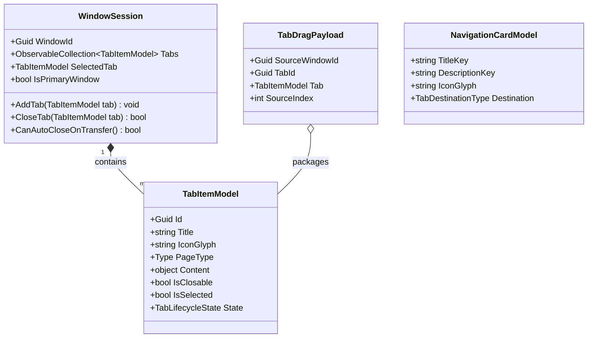
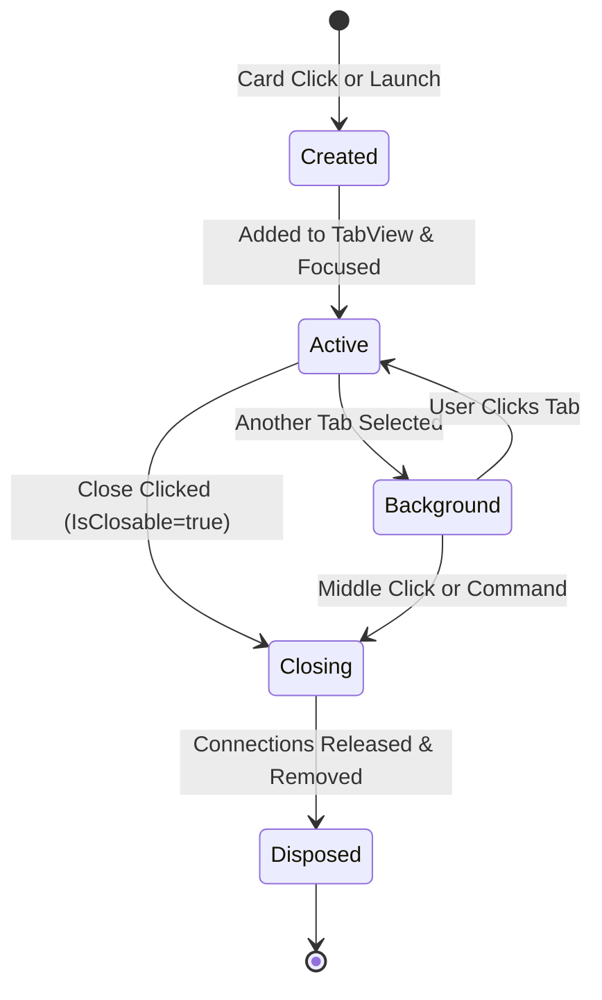

# Data Model & State Architecture: WinUI 3 Modern Tabbed Shell

**Feature**: `001-winui3-chrome-tabs` | **Date**: 2026-10-19

This document details the data structures, entities, state transitions, and behavioral invariants governing the WinUI 3 multi-window tabbed shell for DataSphere.

---

## 1. Entity Architecture

---

## 2. Entity Definitions

### 2.1 `TabItemModel`
Represents an individual document/page tab inside the `TabView` strip.

| Property | Type | Description |
|---|---|---|
| `Id` | `Guid` | Unique identifier for the tab instance. |
| `Title` | `string` | Display text on the tab header (e.g. "Home", "Cơ sở dữ liệu", "Cài Đặt"). |
| `IconGlyph` | `string` | Segoe Fluent Icon glyph or symbol name for tab branding. |
| `PageType` | `Type` | The concrete Page class type associated with the view. |
| `Content` | `object` | The instantiated view or page element rendered in the main viewport. |
| `IsClosable` | `bool` | Determines whether the close button (`X`) is visible and interactive. |
| `IsSelected` | `bool` | Indicates whether the tab is currently active and visible to the user. |
| `State` | `TabLifecycleState` | Current lifecycle state (`Created`, `Active`, `Background`, `Closing`, `Disposed`). |

### 2.2 `WindowSession`
Represents an active top-level native desktop window hosting a `TabView` shell.

| Property | Type | Description |
|---|---|---|
| `WindowId` | `Guid` | Unique session identifier for the window. |
| `WindowInstance` | `Microsoft.UI.Xaml.Window` | Reference to the native WinUI 3 window wrapper. |
| `Tabs` | `ObservableCollection<TabItemModel>` | Collection of all open tabs in this window. |
| `SelectedTab` | `TabItemModel` | Currently active tab displayed in the content host. |
| `IsPrimary` | `bool` | Indicates whether this is the root window created on process start. |

### 2.3 `TabDragPayload`
Transitory metadata package created during drag-and-drop operations for inter-window transfers.

| Field | Type | Description |
|---|---|---|
| `SourceWindowId` | `Guid` | ID of the donor window initiating the drag. |
| `TabId` | `Guid` | Unique ID of the tab being dragged. |
| `Tab` | `TabItemModel` | The tab model being transferred. |
| `SourceIndex` | `int` | Original position index in the donor tab strip. |

---

## 3. Tab Lifecycle State Machine

### State Definitions
1. **`Created`**: Tab model initialized; page view and ViewModel resolved via DI.
2. **`Active`**: Tab is selected in `TabView`; content is visible and interactive.
3. **`Background`**: Tab remains in memory with open connections/state, but view is hidden.
4. **`Closing`**: Close requested; any long-running queries are cancelled via `CancellationToken`.
5. **`Disposed`**: Cleaned up and removed from `Tabs` collection.

---

## 4. Architectural Invariants

### Invariant 1: Uncloseable Anchored Home Tab
- Every `WindowSession` MUST have a `TabItemModel` representing the Home Dashboard at index 0.
- For the Home tab: `IsClosable` MUST BE `false`.
- The system MUST reject any programmatic or gesture-based attempt to remove or close the Home tab.

### Invariant 2: Donor Window Auto-Closure Rule
- When a user transfers a tab from Window A to Window B:
  - If Window A initially contained exactly 2 tabs (`Home` + `ContentTab`),
  - And `ContentTab` is successfully transferred to Window B,
  - Window A is left with only the idle Home tab and NO active user content.
  - Window A MUST automatically call `Close()` and deregister from `IWindowManager`.

### Invariant 3: Deterministic Connection Teardown
- When a `TabItemModel` of type `Cơ sở dữ liệu` is closed, any open `MySqlConnection` associated with that tab session MUST be asynchronously closed and disposed to prevent socket leaks.
