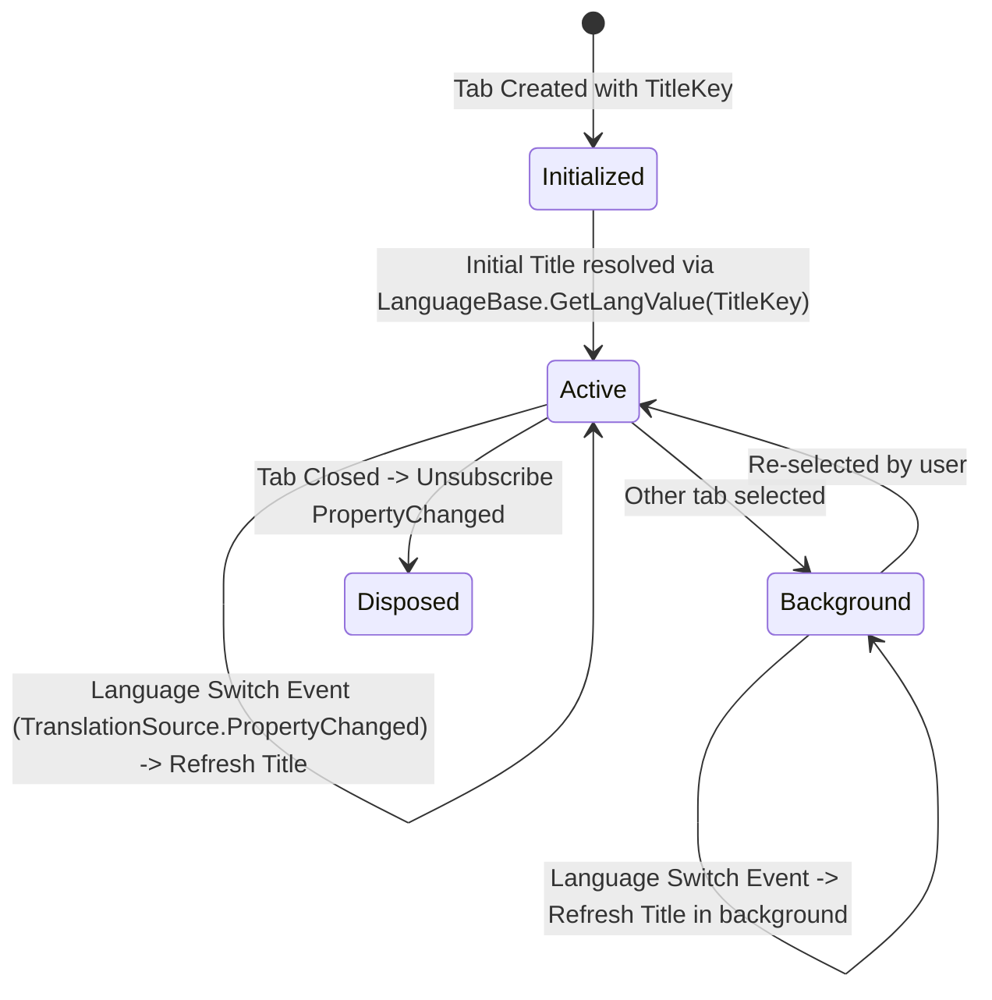
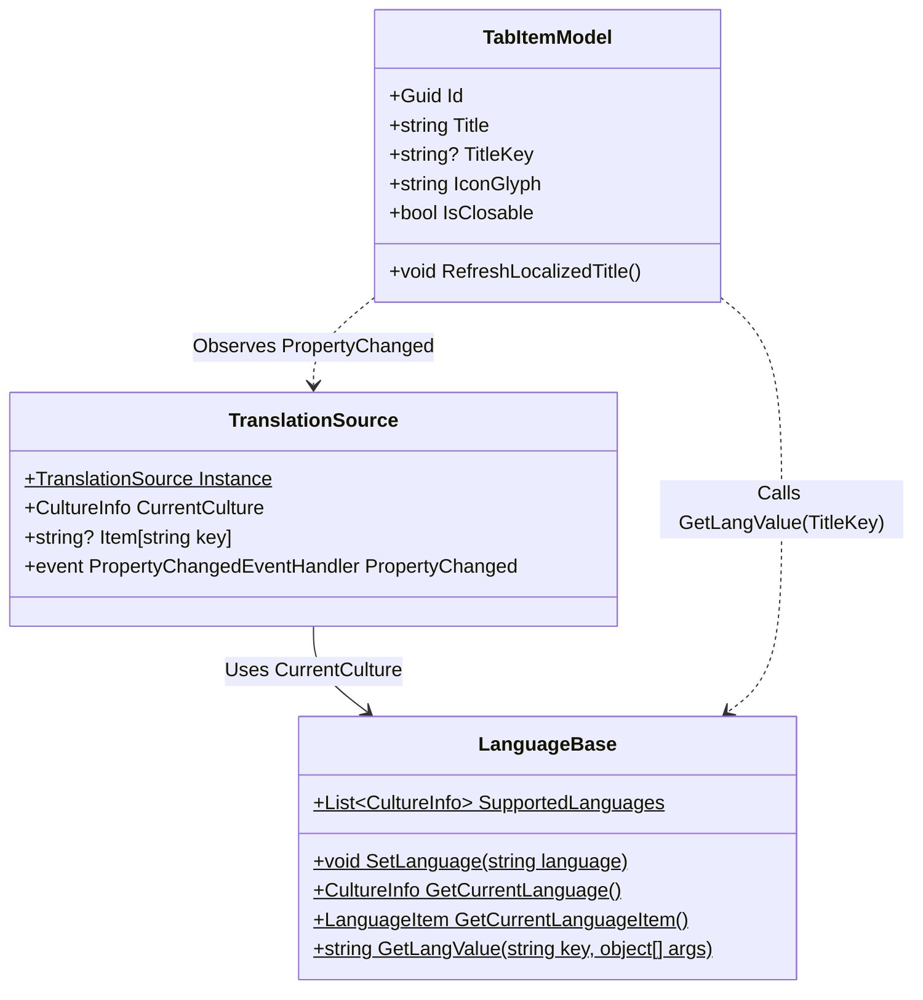

# Data Model: Dynamic i18n & Localization Contracts

**Feature**: `002-dynamic-i18n-localization` | **Date**: 2026-10-19

This document defines the modified and extended data models governing dynamic localization and zero-hardcoded-strings enforcement in DataSphere.

---

## 1. TabItemModel Enhancements

[`TabItemModel`](file:///d:/DEV/C%23DOTNET/DataSphere/DataSphere/Models/TabItemModel.cs) represents a tab in the browser-style Chrome tab strip. It is extended to support dynamic localization keys and culture change event handling.

### Entity Attributes

| Property | Type | Description |
|---|---|---|
| `Id` | `Guid` | Unique tab instance identifier (immutable). |
| `Title` | `string` | Display text on the tab header (observable, refreshed automatically when `TitleKey` is set). |
| `TitleKey` | `string?` | Resource key (e.g., `"page_home_title"`, `"page_db_title"`). When set, enables dynamic localization. |
| `IconGlyph` | `string` | Fluent icon glyph character code. |
| `PageType` | `Type?` | Concrete `Page` class hosted in this tab. |
| `Content` | `object?` | Instantiated UI element rendered in the shell viewport. |
| `IsClosable` | `bool` | `false` for Home tab, `true` for document tabs. |
| `IsSelected` | `bool` | Indicates whether tab is actively selected in the host window. |
| `State` | `TabLifecycleState` | Lifecycle tracking (Created, Active, Background, Closing, Disposed). |
| `Tag` | `object?` | Arbitrary contextual state or ViewModel payload. |

### Localization State Lifecycle

---

## 2. Localization Resource Key Schema

The following key schema standardizes naming conventions in `String.resx`, `String.en.resx`, and `String.vi.resx`:

| Key Prefix | Scope | Example Key | Vietnamese Value | English Value |
|---|---|---|---|---|
| `page_home_` | Home Dashboard | `page_home_title` | `Trang chủ` | `Home` |
| `page_home_` | Home Sections | `page_home_sections_title` | `Các Phân Hệ Chính` | `Main Modules` |
| `page_db_` | Database Module | `page_db_title` | `Cơ sở dữ liệu` | `Databases` |
| `page_db_` | Database Summary | `page_db_summary` | `Quản lý phiên kết nối và cấu trúc dữ liệu` | `Manage database connections and schemas` |
| `page_settings_` | Settings Module | `page_settings_title` | `Cài đặt` | `Settings` |
| `page_settings_` | Settings Summary | `page_settings_summary` | `Tùy biến giao diện và ngôn ngữ` | `Customize appearance and language` |

---

## 3. TranslationSource & LanguageBase Architecture

