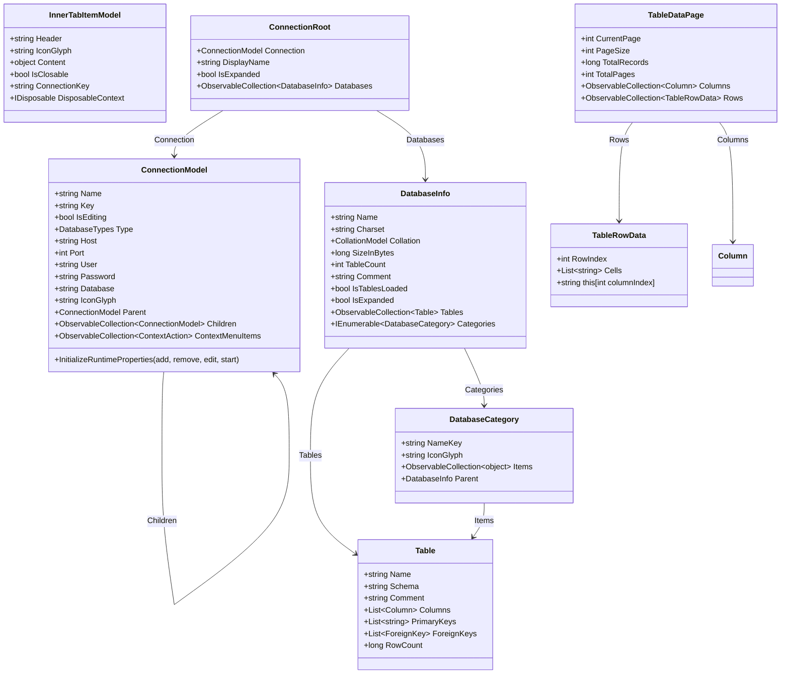

# Data Model: Database Connection Management & Schema Hierarchy

**Feature**: `004-database-connection-management`  
**Date**: 2026-10-20  
**Status**: Completed  

## 1. Domain Entities & Class Models



---

## 2. Entity Specifications

### 2.1 `ConnectionModel`
Represents a persistent database connection or grouping folder.

| Property | Type | Description | Persistence |
|---|---|---|---|
| `Name` | `string` | User-defined connection or folder name | Stored in `connections.json` |
| `Key` | `string` | Unique GUID/identifier | Stored in `connections.json` |
| `IsEditing` | `bool` | Inline renaming flag | Transient |
| `Type` | `DatabaseTypes` | Engine type (`Folder`, `MySql`, `MariaDb`) | Stored in `connections.json` |
| `Host` | `string` | Server IP or hostname (e.g., `127.0.0.1`) | Stored in `connections.json` |
| `Port` | `int` | Network port (e.g., `3306`) | Stored in `connections.json` |
| `User` | `string` | Database authentication username | Stored in `connections.json` |
| `Password` | `string` | Plaintext in memory; **encrypted with AES-CBC on disk** | Encrypted in `connections.json` |
| `Database` | `string` | Default schema name (optional) | Stored in `connections.json` |
| `IconGlyph` | `string` | Segoe Fluent Icon glyph (`\uE774` for DB, `\uE838` for Folder) | Computed |
| `Parent` | `ConnectionModel?` | Parent folder if nested | Transient reference |
| `Children` | `ObservableCollection<ConnectionModel>` | Nested connections/subfolders | Stored in `connections.json` |
| `ContextMenuItems` | `ObservableCollection<ContextAction>?` | Context menu commands | Transient |

### 2.2 `InnerTabItemModel`
Represents an inner sub-tab hosted inside the `TabView` on `DatabasePage`.

| Property | Type | Description |
|---|---|---|
| `Header` | `string` | Tab header text (e.g., "Connections" or connection name) |
| `IconGlyph` | `string` | Fluent icon glyph displayed on the tab header |
| `Content` | `object` | UserControl instance (`ConnectViewControl` or `DatabaseViewControl`) |
| `IsClosable` | `bool` | `false` for Tab 0 (Connections); `true` for connection tabs |
| `ConnectionKey` | `string?` | Matches `ConnectionModel.Key` to prevent duplicate open tabs |
| `DisposableContext` | `IDisposable?` | Reference to dispose when tab is closed |

### 2.3 `ConnectionRoot`
Represents the root node in the object explorer tree for an active connection session.

| Property | Type | Description |
|---|---|---|
| `Connection` | `ConnectionModel` | Active connection configuration |
| `DisplayName` | `string` | Formatted connection header string |
| `IsExpanded` | `bool` | Tree node expansion state |
| `Databases` | `ObservableCollection<DatabaseInfo>` | Retrieved server databases |

### 2.4 `DatabaseInfo` & `DatabaseCategory`
Represents an individual database/schema catalog and its structural categories.

| Property | Type | Description |
|---|---|---|
| `Name` | `string` | Schema name (e.g., `sakila`, `information_schema`) |
| `Charset` | `string` | Character set (e.g., `utf8mb4`) |
| `Collation` | `CollationModel` | Collation definition (e.g., `utf8mb4_unicode_ci`) |
| `SizeInBytes` | `long?` | Estimated disk size in bytes |
| `TableCount` | `int` | Count of tables in schema |
| `IsTablesLoaded` | `bool` | Flag indicating if table metadata has been queried |
| `Tables` | `ObservableCollection<Table>` | Child tables |
| `Categories` | `IEnumerable<DatabaseCategory>` | Standard category nodes (Tables, Views, SPs, Functions, Triggers, Events) |

### 2.5 `TableDataPage` & `TableRowData`
Represents paginated query results rendered in `DataViewControl`.

| Property | Type | Description |
|---|---|---|
| `CurrentPage` | `int` | Active 1-based page index |
| `PageSize` | `int` | Maximum rows per page (100, 500, or 1000) |
| `TotalRecords` | `long` | Total row count in target table |
| `TotalPages` | `int` | Computed as `(int)Math.Ceiling((double)TotalRecords / PageSize)` |
| `Columns` | `ObservableCollection<Column>` | Dynamic column headers with data type metadata |
| `Rows` | `ObservableCollection<TableRowData>` | Paginated row data entries |
| `RowIndex` | `int` | Sequential 1-based row index for display |
| `Cells` | `List<string>` | Formatted string values for each column |

---

## 3. Storage Format (`connections.json`)

Stored in `%LOCALAPPDATA%\DataSphere\connections.json`. Passwords MUST always be stored in encrypted base64 format via `PasswordEncryptor.Encrypt()`:

```json
[
  {
    "Name": "Development MySQL",
    "Key": "b2c9d8e7-1234-4567-89ab-cdef01234567",
    "Type": {
      "Value": 1
    },
    "Host": "127.0.0.1",
    "Port": 3306,
    "User": "root",
    "Password": "ENC(q1w2e3r4t5y6u7i8...encrypted_base64...)",
    "Children": []
  },
  {
    "Name": "Production Servers",
    "Key": "a1b2c3d4-5678-90ab-cdef-1234567890ab",
    "Type": {
      "Value": 0
    },
    "Children": [
      {
        "Name": "Replica Node 1",
        "Key": "f5e4d3c2-b1a0-9876-5432-10fedcba9876",
        "Type": {
          "Value": 1
        },
        "Host": "db-replica.internal",
        "Port": 3306,
        "User": "readonly",
        "Password": "ENC(m9n8b7v6c5x4z3...encrypted_base64...)",
        "Children": []
      }
    ]
  }
]
```
