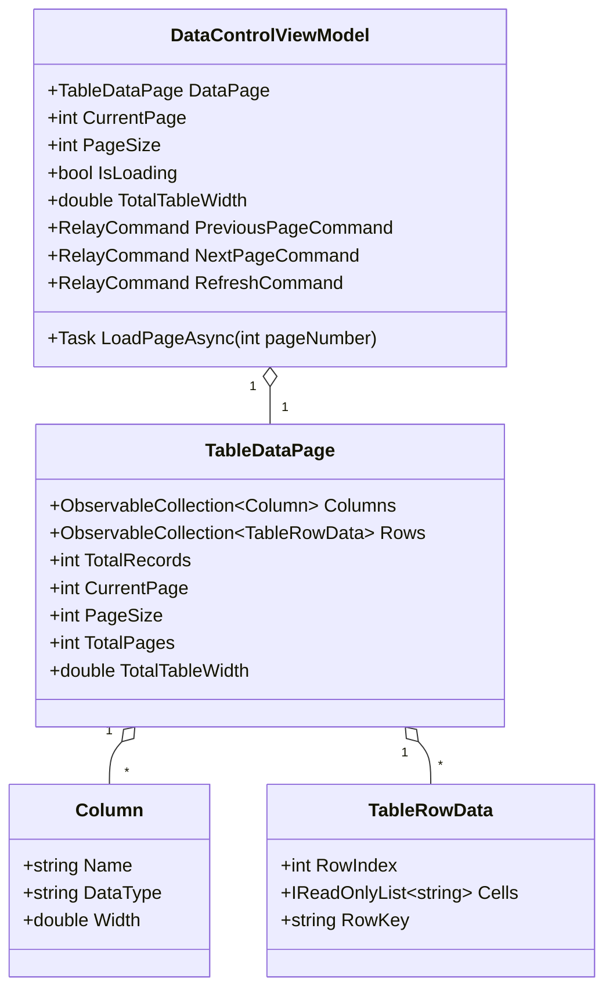
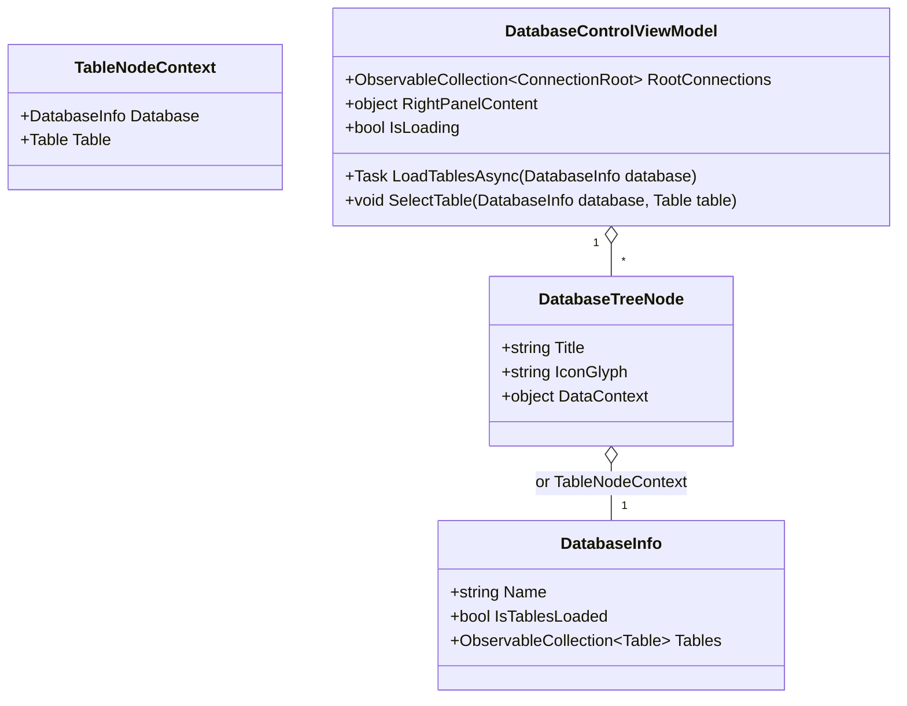

# Data Model & Architecture: Data Table & Schema Tree UI Virtualization

**Branch**: `005-data-and-tree-virtualization` | **Date**: 2026-10-20 | **Spec**: [spec.md](./spec.md)

## 1. Overview

The virtualization subsystem maintains strict separation between high-level database domain models and low-level visual item containers. By modeling data streams as immutable or lightweight POCO records, the XAML virtualization engine (`ItemsStackPanel`) can recycle visual containers without carrying over state, causing layout thrashing, or producing memory leaks.

---

## 2. Entity & Model Definitions

### 2.1 Table Viewport Virtualization Models

#### `TableRowData` (Immutable Row Record)
- **Role**: Represents a single horizontal row of values in the virtualized grid.
- **Properties**:
  - `RowIndex`: 0-based index of the row within the current page.
  - `Cells`: Array or read-only list of string formatted values for each column.
  - `RowKey`: Unique composite identifier for selection tracking and container recycling validation.
- **Invariants**: Pure POCO, contains zero visual references (`UIElement`, `Brush`, `FontIcon`).

#### `Column`
- **Role**: Describes the schema and layout sizing of a table column.
- **Properties**:
  - `Name`: Column name in the database table.
  - `DataType`: Visual type string (e.g. `Int32`, `String`, `DateTime`).
  - `Width`: Explicit fixed or calculated column width (default: 140px) ensuring consistent cell alignment.

#### `TableDataPage`
- **Role**: Encapsulates the active chunk of virtualized data.
- **Calculated Properties**:
  - `TotalTableWidth`: Sum of all column widths plus inter-column spacing, binding to the `MinWidth` of the horizontally-scrollable content area.

---

### 2.2 Schema Tree Virtualization Models

#### `DatabaseTreeNode` (Pure Data Payload)
- **Role**: Attached to `TreeViewNode.Content`.
- **Properties**:
  - `Title`: Display string for the node.
  - `IconGlyph`: Segoe Fluent Icon glyph code (e.g. `\uEDA2` for database, `\uE8B7` for table folder, `\uF0E2` for table).
  - `DataContext`: Backing domain object (`DatabaseInfo`, `ConnectionRoot`, or `TableNodeContext`).
- **Invariants**: Inherits from standard C# `object`, never inherits from `UIElement`. Completely safe for TreeView container recycling across virtualized viewports.

---

## 3. Visual Layout Specifications

### 3.1 Data Viewport Grid Alignment
- **Row Heights**: Fixed height per row (`40px`) inside `ListViewItem` to allow instantaneous offset calculation in `ItemsStackPanel`.
- **Column Widths**: 140px standard with `CharacterEllipsis` trimming.
- **Cache Buffer**: `ItemsStackPanel.CacheLength="2.0"` ensures 2 pages of off-screen items are held in memory ready for instantaneous appearance during fast wheel scrolling.

### 3.2 TreeView Virtualization Settings
- **Item Container Sizing**: Fixed item height (36px) via `TreeViewItem` style.
- **Tree Node Indentation**: Explicit level multipliers (Level 0 = 0px, Level 1 = 16px, Level 2 = 32px, Level 3 = 48px).
- **Asynchronous Lazy Realization**: `HasUnrealizedChildren = true` until user expands, preventing tree graph explosion on servers with thousands of schemas.
