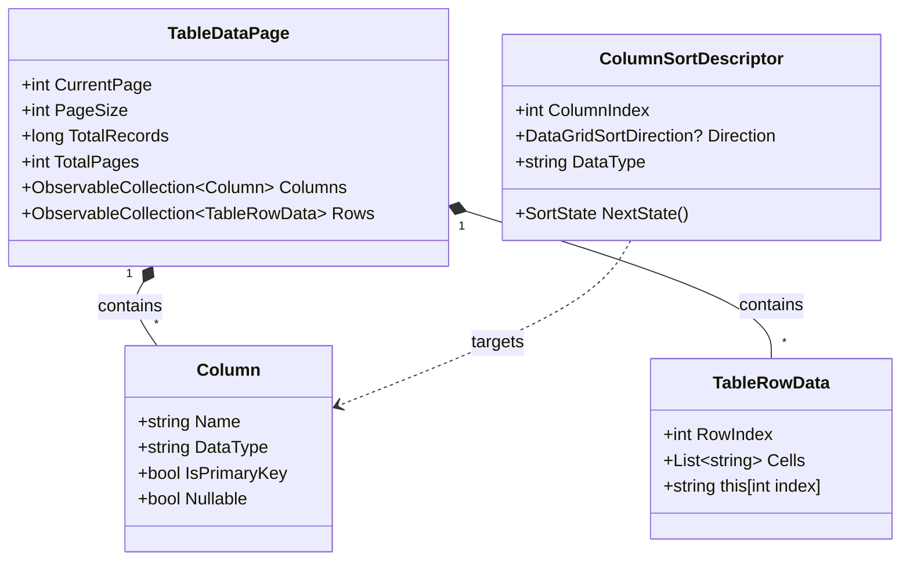
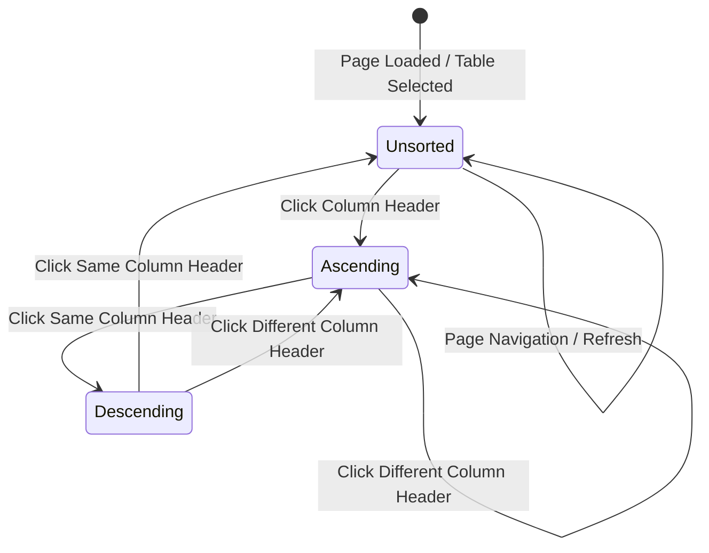

# Data Model: Native CommunityToolkit DataGrid with Interactive Sorting

- **Feature**: `006-datagrid-table-view`
- **Date**: 2026-10-21
- **Status**: Complete

---

## 1. Entities & Data Structures



### 1.1 `Column` (Metadata)
Represents the structural definition of a database column:
- `Name`: Column name displayed in the grid header.
- `DataType`: SQL data type string (e.g. `int`, `varchar(255)`, `datetime`, `decimal(10,2)`).
- `IsPrimaryKey`: Flag indicating whether the column forms part of the primary key.
- `Nullable`: Whether the column accepts `NULL` values.

### 1.2 `TableRowData` (Row Data Record)
Represents a row slice in memory:
- `RowIndex`: 1-based sequential index within the dataset, used for natural order restoration.
- `Cells`: `List<string>` holding formatted textual representations of each column value.
- Indexer `this[int index]`: Direct $O(1)$ cell value lookup.

### 1.3 `ColumnSortDescriptor` (Sort Configuration)
Represents active sort criteria applied to the loaded page:
- `ColumnIndex`: Zero-based column ordinal being sorted.
- `Direction`: `DataGridSortDirection?` (`Ascending`, `Descending`, or `null`).
- `DataType`: Column data type used for type-aware comparisons.

---

## 2. Type-Aware Sort Comparison Strategy

When sorting column values, string values are parsed dynamically based on the detected SQL data type category:

```
Category         SQL Types                            Comparison Parsing Logic
────────────────────────────────────────────────────────────────────────────────
Integer          int, bigint, smallint, tinyint       long.TryParse(cell, out val)
Floating/Decimal decimal, numeric, float, double      double.TryParse(cell, out val)
DateTime         datetime, timestamp, date, time      DateTime.TryParse(cell, out val)
Text / Fallback  varchar, text, char, enum, json      string.Compare(cellA, cellB, OrdinalIgnoreCase)
```

### NULL Value Handling Rules:
- String representation `"NULL"` or empty `""` is treated as null.
- Under **Ascending** order: NULL values appear at the **end** (or bottom).
- Under **Descending** order: NULL values appear at the **end** (or bottom), preserving clean data inspection.

---

## 3. State Transitions


