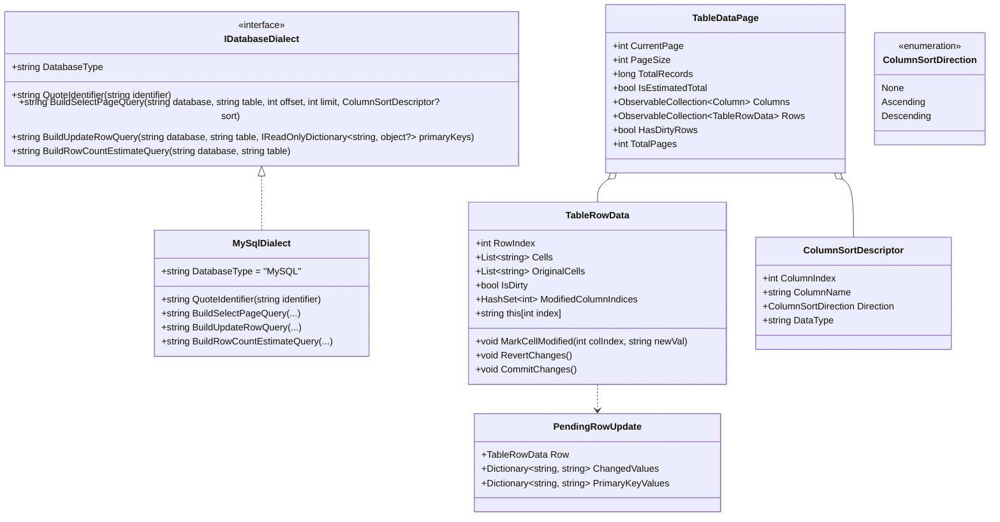
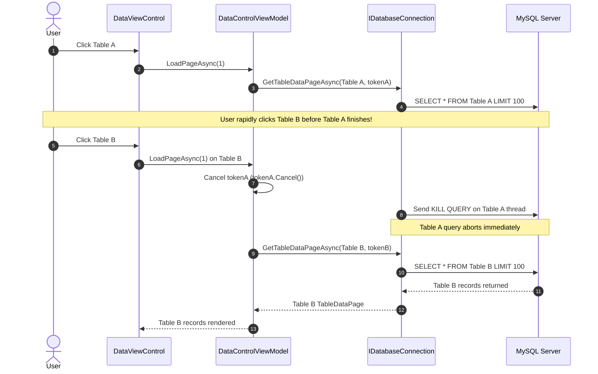

# Data Model & Architecture: High-Performance Data Pipeline, Server-Side Sorting, and In-Place Table Editor

**Feature**: `007-table-editor-and-query-pipeline`  
**Date**: 2026-10-21  

---

## 1. Entity Relationship & Class Hierarchy



---

## 2. Model Specifications

### 2.1 `IDatabaseDialect` & `MySqlDialect`
Located in `DataSphere/Services/Database/Dialect/`:

```csharp
namespace DataSphere.Services.Database.Dialect
{
    /// <summary>
    /// Defines database dialect operations for SQL query building and identifier quoting.
    /// </summary>
    public interface IDatabaseDialect
    {
        /// <summary>
        /// Gets the dialect engine identifier (e.g. "MySQL", "MariaDB", "PostgreSQL").
        /// </summary>
        string DatabaseType { get; }

        /// <summary>
        /// Quotes a database object identifier (table, column, schema) to prevent injection and keyword collisions.
        /// </summary>
        string QuoteIdentifier(string identifier);

        /// <summary>
        /// Generates a paginated select query with optional server-side sorting.
        /// </summary>
        string BuildSelectPageQuery(string database, string table, int offset, int limit, ColumnSortDescriptor? sort);

        /// <summary>
        /// Generates a parameterized update query for modified row values based on primary key predicates.
        /// </summary>
        string BuildUpdateRowQuery(string database, string table, IReadOnlyDictionary<string, object?> changedValues, IReadOnlyDictionary<string, object?> primaryKeys);

        /// <summary>
        /// Generates an instantaneous row count query using schema engine statistics (e.g. information_schema.TABLES).
        /// </summary>
        string BuildRowCountEstimateQuery(string database, string table);
    }
}
```

### 2.2 Enhanced `TableRowData`
Located in `DataSphere/Models/TableDataPage.cs`:

- **Original Snapshot Storage**: `OriginalCells` stores the baseline values retrieved from the database.
- **Dirty State Tracking**: `IsDirty` indicates if any cell has uncommitted changes.
- **Modified Columns Tracking**: `ModifiedColumnIndices` tracks exactly which columns were edited so only changed fields are included in the generated SQL `UPDATE` statement.

```csharp
public class TableRowData
{
    public int RowIndex { get; set; }
    public List<string> Cells { get; set; } = new();
    public List<string> OriginalCells { get; set; } = new();
    public bool IsDirty { get; set; }
    public HashSet<int> ModifiedColumnIndices { get; } = new();

    public void MarkCellModified(int columnIndex, string newValue)
    {
        if (columnIndex >= 0 && columnIndex < Cells.Count)
        {
            Cells[columnIndex] = newValue;
            if (columnIndex < OriginalCells.Count && OriginalCells[columnIndex] != newValue)
            {
                ModifiedColumnIndices.Add(columnIndex);
                IsDirty = true;
            }
            else
            {
                ModifiedColumnIndices.Remove(columnIndex);
                IsDirty = ModifiedColumnIndices.Count > 0;
            }
        }
    }

    public void RevertChanges()
    {
        for (int i = 0; i < Math.Min(Cells.Count, OriginalCells.Count); i++)
        {
            Cells[i] = OriginalCells[i];
        }
        ModifiedColumnIndices.Clear();
        IsDirty = false;
    }

    public void CommitChanges()
    {
        OriginalCells = Cells.ToList();
        ModifiedColumnIndices.Clear();
        IsDirty = false;
    }
}
```

### 2.3 Enhanced `TableDataPage`
Located in `DataSphere/Models/TableDataPage.cs`:
- Adds `bool IsEstimatedTotal { get; set; }` to indicate whether the total row count is based on engine statistics (`information_schema`) or an exact count.
- Adds `bool HasDirtyRows => Rows.Any(r => r.IsDirty);` for View and ViewModel change tracking.

---

## 3. Query Cancellation Life Cycle


