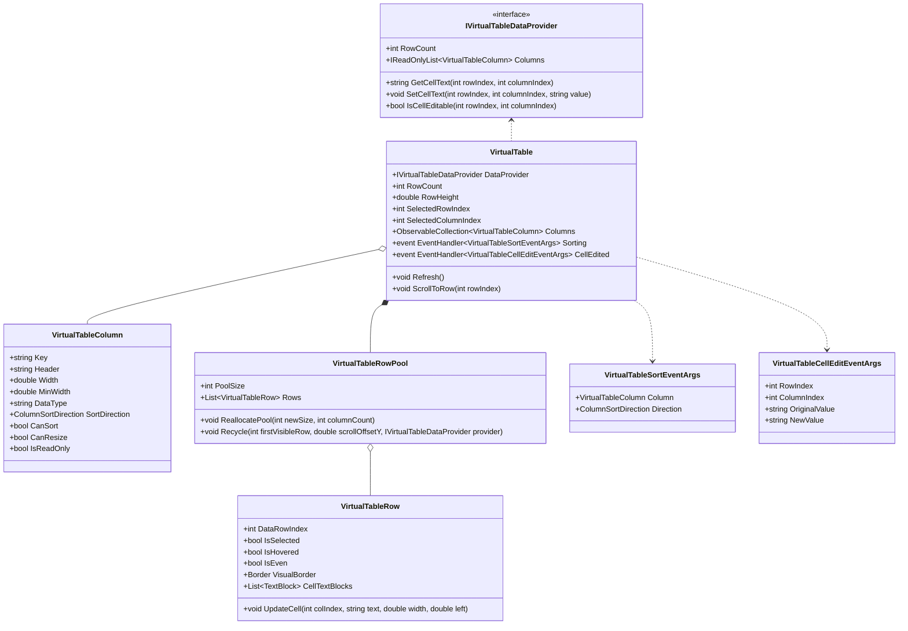
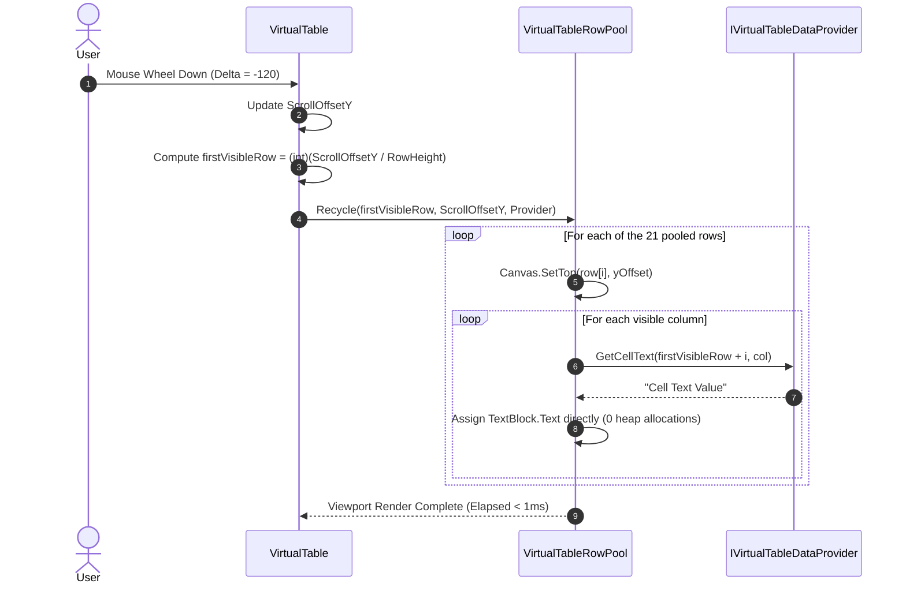

# Data Model & Architecture: High-Performance WinUI 3 VirtualTable Control

**Feature**: `008-virtual-table-control`  
**Date**: 2026-10-21  

---

## 1. Class Diagram & Architecture



---

## 2. Component Structure

### 2.1 `IVirtualTableDataProvider`
Located in `DataSphere/Controls/VirtualTable/`:

```csharp
namespace DataSphere.Controls.VirtualTable
{
    /// <summary>
    /// Contract defining on-demand data delivery for the VirtualTable control.
    /// </summary>
    public interface IVirtualTableDataProvider
    {
        /// <summary>
        /// Gets the total number of records available in the dataset.
        /// </summary>
        int RowCount { get; }

        /// <summary>
        /// Gets the collection of column definitions.
        /// </summary>
        IReadOnlyList<VirtualTableColumn> Columns { get; }

        /// <summary>
        /// Retrieves the formatted string display value for the specified cell coordinates.
        /// </summary>
        /// <param name="rowIndex">The 0-based data row index.</param>
        /// <param name="columnIndex">The 0-based column index.</param>
        /// <returns>The cell text string.</returns>
        string GetCellText(int rowIndex, int columnIndex);

        /// <summary>
        /// Updates the cell value at the specified coordinates.
        /// </summary>
        void SetCellText(int rowIndex, int columnIndex, string value);

        /// <summary>
        /// Determines whether the cell at the specified coordinates can be edited in-place.
        /// </summary>
        bool IsCellEditable(int rowIndex, int columnIndex);
    }
}
```

### 2.2 `VirtualTableColumn`
Located in `DataSphere/Controls/VirtualTable/`:

```csharp
namespace DataSphere.Controls.VirtualTable
{
    /// <summary>
    /// Represents a column in the VirtualTable control.
    /// </summary>
    public class VirtualTableColumn
    {
        public string Key { get; set; } = string.Empty;
        public string Header { get; set; } = string.Empty;
        public double Width { get; set; } = 140;
        public double MinWidth { get; set; } = 60;
        public string DataType { get; set; } = "string";
        public ColumnSortDirection SortDirection { get; set; } = ColumnSortDirection.None;
        public bool CanSort { get; set; } = true;
        public bool CanResize { get; set; } = true;
        public bool IsReadOnly { get; set; } = false;
    }
}
```

### 2.3 `VirtualTableRowPool`
Located in `DataSphere/Controls/VirtualTable/`:
- Manages the fixed collection of visual row containers.
- Reallocates only when viewport height changes (e.g. window resize).
- Zero allocations during scrolling: re-indexes rows and invokes `GetCellText`.

---

## 3. Scrolling Execution Flow


