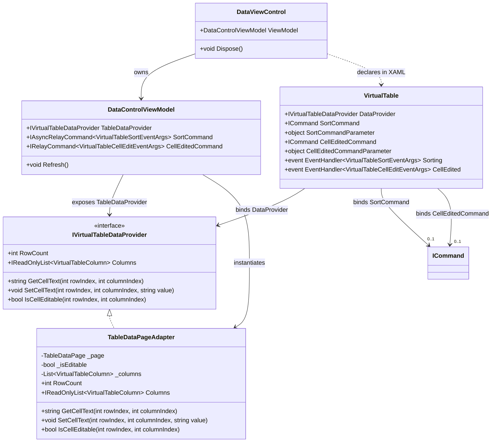

# Data Model & Architectural Contracts: VirtualTable MVVM Binding

- **Feature**: `009-virtual-table-mvvm-binding`
- **Date**: 2026-10-21
- **Layer**: Presentation & Control Architecture

---

## 1. Class & Interface Diagram



---

## 2. Component Specifications

### 2.1 `VirtualTable` Dependency Properties

| Dependency Property | Type | Default | Description |
|---------------------|------|---------|-------------|
| `DataProvider` | `IVirtualTableDataProvider?` | `null` | The data source supplying row/column virtualization. |
| `SortCommand` | `System.Windows.Input.ICommand?` | `null` | Command executed when a column header sort is clicked. |
| `SortCommandParameter` | `object?` | `null` | Optional parameter for `SortCommand`. Defaults to `VirtualTableSortEventArgs`. |
| `CellEditedCommand` | `System.Windows.Input.ICommand?` | `null` | Command executed when a cell modification is committed. |
| `CellEditedCommandParameter` | `object?` | `null` | Optional parameter for `CellEditedCommand`. Defaults to `VirtualTableCellEditEventArgs`. |

### 2.2 Event Arguments Data Contracts

#### `VirtualTableSortEventArgs`
```csharp
namespace DataSphere.Controls.VirtualTable
{
    public class VirtualTableSortEventArgs : EventArgs
    {
        public VirtualTableColumn Column { get; }
        public ColumnSortDirection Direction { get; }

        public VirtualTableSortEventArgs(VirtualTableColumn column, ColumnSortDirection direction)
        {
            Column = column;
            Direction = direction;
        }
    }
}
```

#### `VirtualTableCellEditEventArgs`
```csharp
namespace DataSphere.Controls.VirtualTable
{
    public class VirtualTableCellEditEventArgs : EventArgs
    {
        public int RowIndex { get; }
        public int ColumnIndex { get; }
        public string OriginalValue { get; }
        public string NewValue { get; }

        public VirtualTableCellEditEventArgs(int rowIndex, int columnIndex, string originalValue, string newValue)
        {
            RowIndex = rowIndex;
            ColumnIndex = columnIndex;
            OriginalValue = originalValue;
            NewValue = newValue;
        }
    }
}
```

### 2.3 `TableDataPageAdapter`
Located in `DataSphere.Models.Database` (or `DataSphere.ViewModels.Pages.DatabaseGroup`), bridging raw database records (`TableDataPage`) to `IVirtualTableDataProvider` without referencing any UI elements.
