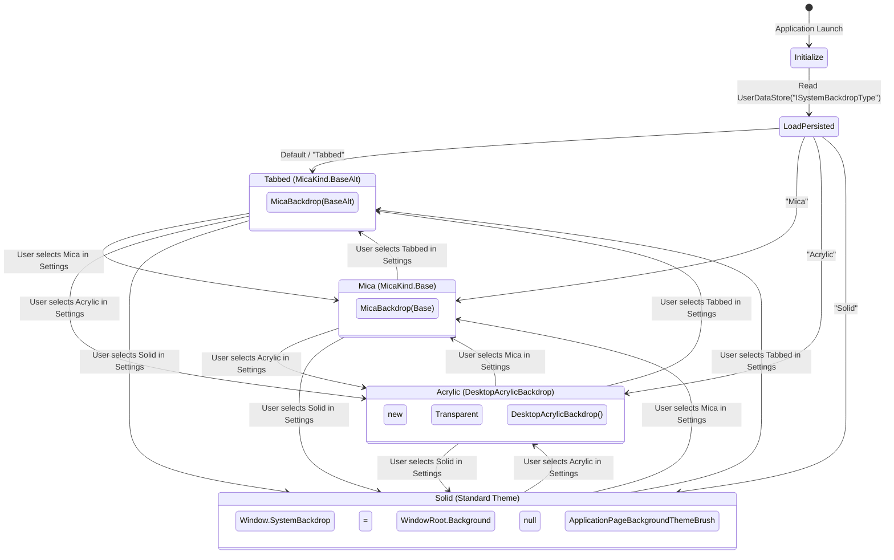

# Data Model: Fluent Settings & System Backdrops

**Feature**: `010-fluent-settings-and-system-backdrops`
**Date**: 2026-10-21T14:13:30+07:00

---

## 1. Entities & Models

### 1.1 `BackdropOptionItem`
Located in `DataSphere.Models`:

```csharp
namespace DataSphere.Models
{
    /// <summary>
    /// Represents a selectable system backdrop material option in the personalization settings.
    /// </summary>
    public sealed class BackdropOptionItem
    {
        /// <summary>
        /// Gets or sets the unique technical key identifying the backdrop material ("Mica", "Tabbed", "Acrylic", "Solid").
        /// </summary>
        public string Key { get; set; } = string.Empty;

        /// <summary>
        /// Gets or sets the localized display title of the backdrop material.
        /// </summary>
        public string Content { get; set; } = string.Empty;

        /// <summary>
        /// Gets or sets the localized summary description of the backdrop material.
        /// </summary>
        public string Summary { get; set; } = string.Empty;

        /// <summary>
        /// Gets or sets the Segoe Fluent Icon glyph representing the material.
        /// </summary>
        public string IconGlyph { get; set; } = "\uE790";
    }
}
```

---

## 2. Service Contracts & State Transitions

### 2.1 `IThemeService` Extension
Located in `DataSphere.Services.Contracts`:

```csharp
namespace DataSphere.Services.Contracts
{
    /// <summary>
    /// Contract managing application themes and Windows system backdrops.
    /// </summary>
    public interface IThemeService
    {
        /// <summary>
        /// Gets the active application theme ("Light", "Dark", "Default").
        /// </summary>
        string CurrentTheme { get; }

        /// <summary>
        /// Gets the active system backdrop type ("Mica", "Tabbed", "Acrylic", "Solid").
        /// </summary>
        string CurrentBackdrop { get; }

        /// <summary>
        /// Occurs when the application theme changes.
        /// </summary>
        event EventHandler<string>? ThemeChanged;

        /// <summary>
        /// Occurs when the active system backdrop changes.
        /// </summary>
        event EventHandler<string>? BackdropChanged;

        /// <summary>
        /// Sets the active application theme.
        /// </summary>
        /// <param name="theme">The theme identifier.</param>
        void SetTheme(string theme);

        /// <summary>
        /// Sets the active system backdrop material.
        /// </summary>
        /// <param name="backdrop">The backdrop identifier ("Mica", "Tabbed", "Acrylic", "Solid").</param>
        void SetBackdrop(string backdrop);
    }
}
```

---

## 3. Storage & State Persistence

| Setting Key | Type | Default Value | Description |
|---|---|---|---|
| `IThemeType` | `string` | `"Default"` | Persisted application theme mode (`"Light"`, `"Dark"`, `"Default"`). |
| `ISystemBackdropType` | `string` | `"Tabbed"` | Persisted system backdrop material (`"Mica"`, `"Tabbed"`, `"Acrylic"`, `"Solid"`). Defaults to `"Tabbed"` for optimal chrome tab contrast. |
| `ILanguageCode` | `string` | `"vi-VN"` | Persisted application display language. |

---

## 4. Backdrop State Machine


