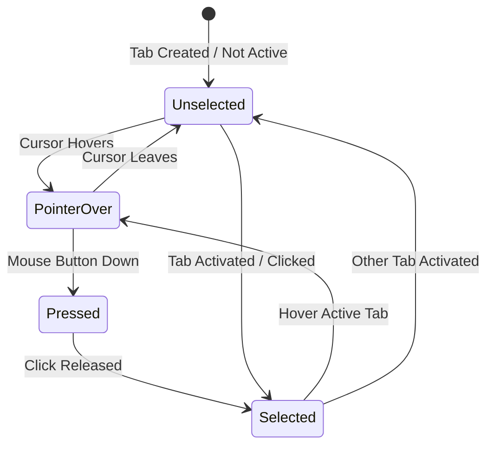

# Visual & Component Model: Pill-Shaped TabViewItem Styling and Borderless TabStrip

**Feature Branch**: `012-pill-tabview-styling`
**Date**: 2026-10-21
**Spec**: [spec.md](./spec.md) | **Research**: [research.md](./research.md)

## Component Visual Specification

### `PillTabViewItemStyle`

Applies modern capsule pill styling to WinUI 3 `TabViewItem` controls.

```xml
<Style x:Key="PillTabViewItemStyle" TargetType="TabViewItem">
    <Setter Property="CornerRadius" Value="16" />
    <Setter Property="Margin" Value="3,4,3,4" />
    <Setter Property="MinHeight" Value="34" />
    <Setter Property="Padding" Value="12,4,8,4" />
    <Setter Property="VerticalAlignment" Value="Center" />
</Style>
```

---

## Theme Resource Tokens & Overrides

| Token Key | Type | Default WinUI 3 Value | Borderless Pill Value | Purpose |
|---|---|---|---|---|
| `TabViewBorderThickness` | `Thickness` | `0,0,0,1` | `0` | Eliminates horizontal dividing line beneath TabStrip |
| `TabViewBorderBrush` | `Brush` | System control stroke | `Transparent` | Transparent divider line |
| `TabViewTabStripBorderThickness` | `Thickness` | `0,0,0,1` | `0` | Eliminates TabStrip internal bottom stroke |
| `TabViewItemStroke` | `Brush` | Tab separator brush | `Transparent` | Eliminates vertical separator line between tabs |
| `TabViewItemSeparator` | `Brush` | Tab separator brush | `Transparent` | Eliminates separator line |
| `TabViewItemCornerRadius` | `CornerRadius` | `4,4,0,0` | `16` | Fully rounded capsule/pill shape on all 4 corners |
| `TabViewItemHeaderMinHeight` | `Double` | `32` | `34` | Consistent capsule height |

---

## Visual States & Surface Brushes



### Visual State Tokens:
1. **Unselected State**:
   - `Background`: `Transparent`
   - `BorderBrush`: `Transparent`
   - `Foreground`: `{ThemeResource TextFillColorSecondaryBrush}`
2. **PointerOver (Hover) State**:
   - `Background`: `{ThemeResource SubtleFillColorSecondaryBrush}`
   - `BorderBrush`: `{ThemeResource CardStrokeColorDefaultBrush}`
   - `Foreground`: `{ThemeResource TextFillColorPrimaryBrush}`
3. **Selected (Active) State**:
   - `Background`: `{ThemeResource CardBackgroundFillColorDefaultBrush}`
   - `BorderBrush`: `{ThemeResource CardStrokeColorDefaultBrush}`
   - `Foreground`: `{ThemeResource TextFillColorPrimaryBrush}`
   - Pill is floating and elevated above the backdrop surface.
4. **Pressed State**:
   - `Background`: `{ThemeResource SubtleFillColorTertiaryBrush}`
   - `BorderBrush`: `{ThemeResource CardStrokeColorDefaultBrush}`
