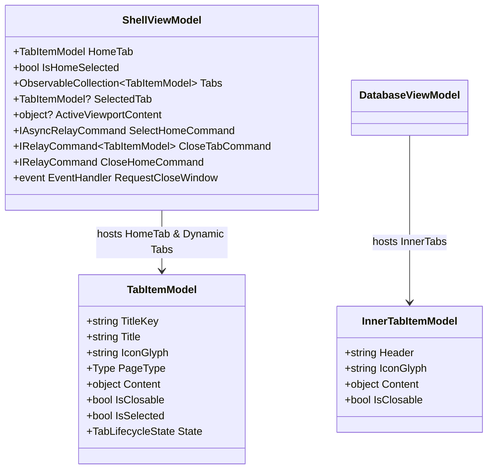

# Component & State Model: Home Tab in TabStripHeader and Unified Tab Styling

**Branch**: `013-home-tab-tabstripheader`
**Date**: 2026-10-22
**Spec**: [spec.md](./spec.md)

---

## 1. Entity Architecture



---

## 2. Shell State Machine

```mermaid
stateDiagram-v2
    [*] --> HomeOnly: Application Startup

    state HomeOnly {
        DynamicTabs_Count: 0
        IsHomeSelected: true
        HomeClosable: true
        ActiveViewport: HomePage
        CloseAction: Exits Application
    }

    state DynamicTabActive {
        DynamicTabs_Count: >= 1
        IsHomeSelected: false
        HomeClosable: false
        ActiveViewport: SelectedTab.Content
        CloseAction: Closed via dynamic tab X
    }

    state HomeActiveWithWorkTabs {
        DynamicTabs_Count: >= 1
        IsHomeSelected: true
        HomeClosable: false
        ActiveViewport: HomePage
        CloseAction: None (Home X is hidden)
    }

    HomeOnly --> DynamicTabActive: OpenTab(connection/database)
    DynamicTabActive --> HomeActiveWithWorkTabs: Click Home in TabStripHeader
    HomeActiveWithWorkTabs --> DynamicTabActive: Click Dynamic Tab
    DynamicTabActive --> DynamicTabActive: Switch/Add Dynamic Tabs
    DynamicTabActive --> HomeOnly: Close last remaining Dynamic Tab
    HomeActiveWithWorkTabs --> HomeOnly: Close all Dynamic Tabs
    HomeOnly --> [*]: Click Home X (RequestCloseWindow)
```

---

## 3. State Invariants & Validation Rules

| Invariant | Expression | Enforcement Mechanism |
|---|---|---|
| **Home Immobility** | `HomeTab ∉ ShellTabView.TabItemsSource` | Home resides in `TabStripHeader`. Can never be dragged, reordered, or torn off. |
| **Home Closability Rule 1** | `HomeTab.IsClosable == true` iff `Tabs.Count == 0` | Reactive update in `Tabs.CollectionChanged` handler in `ShellViewModel`. |
| **Home Closability Rule 2** | `HomeTab.IsClosable == false` when `Tabs.Count >= 1` | Reactive update in `Tabs.CollectionChanged` handler in `ShellViewModel`. |
| **Session Termination Rule** | `CloseHome()` triggers `RequestCloseWindow` | Guarded by `HomeTab.IsClosable && Tabs.Count == 0`. |
| **Mutual Selection Exclusion** | `IsHomeSelected ^ (SelectedTab != null)` when `Tabs.Count > 0` | Setter logic synchronizes `IsHomeSelected` and `SelectedTab`. |
| **Viewport Integrity** | `ActiveViewportContent` strictly non-null | Bound to `HomeTab.Content` or `SelectedTab.Content`. |
