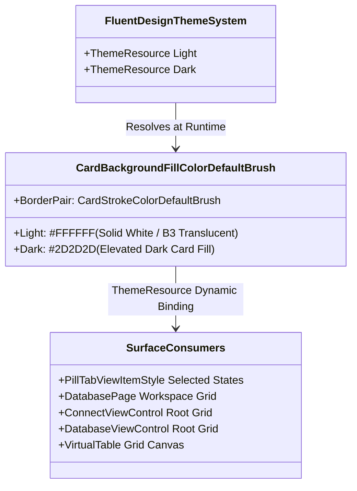
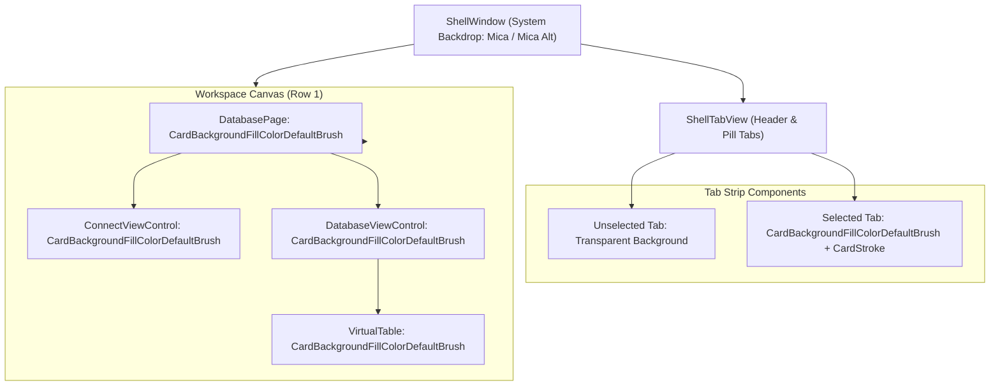
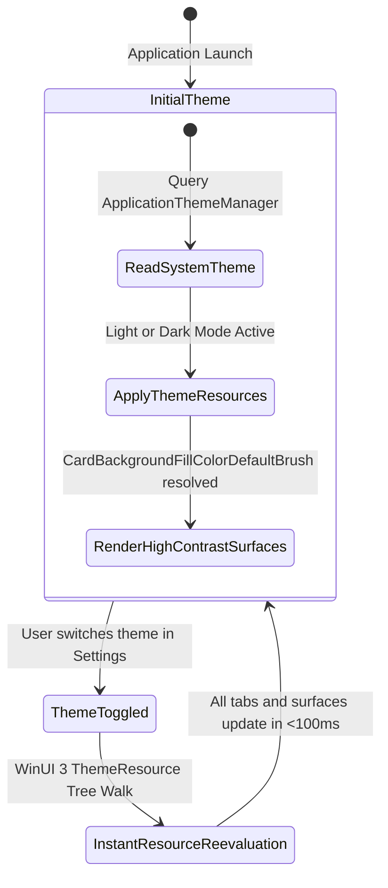

# Data Model & Theme Token Architecture: Surface & Tab Selected Theme Brush Contrast Enhancement

**Feature**: `015-surface-brush-contrast`
**Spec**: [spec.md](./spec.md)
**Research**: [research.md](./research.md)

---

## 1. Theme Resource Token Mapping

The feature standardizes visual surfaces across Light and Dark theme dictionaries using native WinUI 3 Fluent 2 design tokens:

---

## 2. Visual State Mapping in `PillTabViewItemStyle`

In `DataSphere/Themes/TabStyles.xaml`, the `PillBorder` element transitions between visual states based on user interaction:

| Visual State | Target Element | Property | Previous Token (Faint in Dark) | New Standard Token (Elevated Contrast) |
|---|---|---|---|---|
| `Normal` | `PillBorder` | `Background` | `Transparent` | `Transparent` (Unchanged) |
| `PointerOver` | `PillBorder` | `Background` | `SubtleFillColorSecondaryBrush` | `SubtleFillColorSecondaryBrush` (Unchanged) |
| `Pressed` | `PillBorder` | `Background` | `SubtleFillColorTertiaryBrush` | `SubtleFillColorTertiaryBrush` (Unchanged) |
| **`Selected`** | `PillBorder` | `Background` | `LayerFillColorDefaultBrush` ❌ | **`CardBackgroundFillColorDefaultBrush`** ✅ |
| **`PointerOverSelected`** | `PillBorder` | `Background` | `LayerFillColorDefaultBrush` ❌ | **`CardBackgroundFillColorDefaultBrush`** ✅ |
| **`PressedSelected`** | `PillBorder` | `Background` | `LayerFillColorDefaultBrush` ❌ | **`CardBackgroundFillColorDefaultBrush`** ✅ |

---

## 3. Container Surface Hierarchy

---

## 4. Theme Transition Lifecycle State Machine

