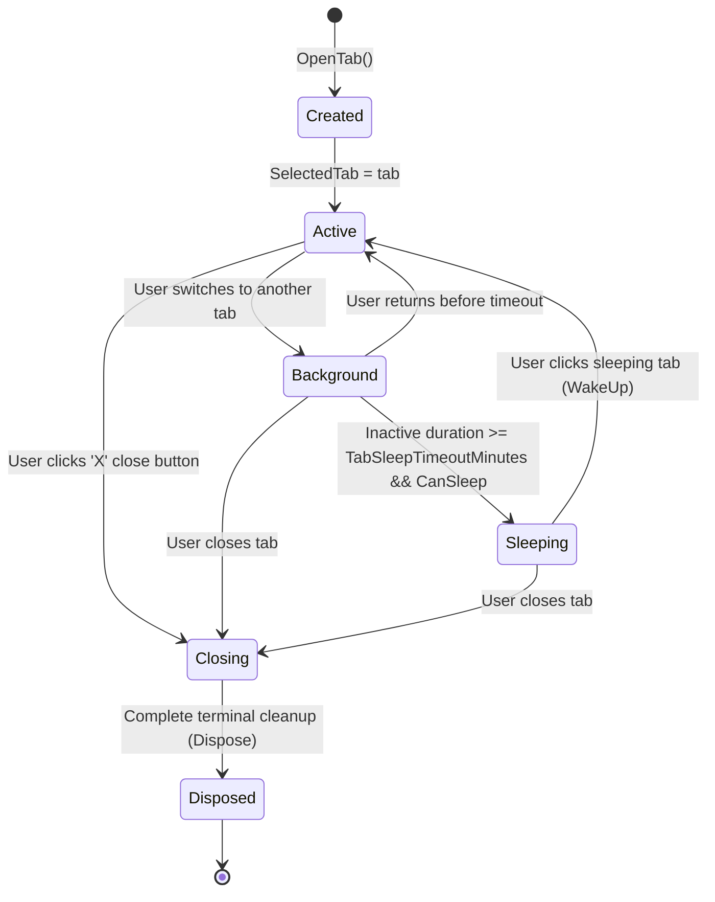

# Data Model: Tab Sleeping & Memory Saver

- **Feature**: `016-tab-sleeping-memory-saver`
- **Date**: 2026-10-23
- **Status**: Completed

## 1. Entities & Enums

### 1.1 `TabLifecycleState` (Enum Enhancement)

```csharp
namespace DataSphere.Models
{
    /// <summary>
    /// Represents the operational lifecycle state of an application tab.
    /// </summary>
    public enum TabLifecycleState
    {
        Created,
        Active,
        Background,
        Sleeping,
        Closing,
        Disposed
    }
}
```

### 1.2 `TabItemModel` (Model Properties)

| Property | Type | Description |
|---|---|---|
| `LastActiveTime` | `DateTime` | UTC timestamp of when the tab was last focused or interacted with. |
| `IsSleeping` | `bool` | Observable flag indicating if the tab is currently in low-power sleeping state. |
| `CanSleep` | `bool` | Computed property: `IsClosable && PageType?.Name != "HomePage" && !HasUnsavedChanges`. |
| `HasUnsavedChanges` | `bool` | Indicates whether the tab has pending edits that prevent automated sleep. |

### 1.3 `TabMemorySaverSettings` (Settings Model)

| Property | Type | Default | Description |
|---|---|---|---|
| `EnableTabMemorySaver` | `bool` | `true` | Master switch enabling automated sleeping of background tabs. |
| `TabSleepTimeoutMinutes` | `int` | `15` | Inactive duration in minutes before putting a background tab to sleep (options: 5, 15, 30, 60). |

### 1.4 `TabSleepTimeoutOption` (UI Option Model)

```csharp
public class TabSleepTimeoutOption
{
    public int Minutes { get; init; }
    public string DisplayName { get; init; } = string.Empty;
}
```

---

## 2. State Transition Lifecycle



---

## 3. Validation Rules

1. **Active Tab Exclusion**: A tab whose `IsSelected == true` MUST NEVER transition to `Sleeping`.
2. **Unsaved Edits Protection**: A tab where `HasUnsavedChanges == true` MUST NOT transition to `Sleeping`.
3. **Timeout Boundaries**: `TabSleepTimeoutMinutes` MUST be one of `{ 5, 15, 30, 60 }`.
4. **Instant Wakeup**: Upon `SelectedTab` reassignment, if the incoming tab is `Sleeping`, it MUST synchronously or asynchronously trigger `WakeUp()` and immediately transition to `Active`.
