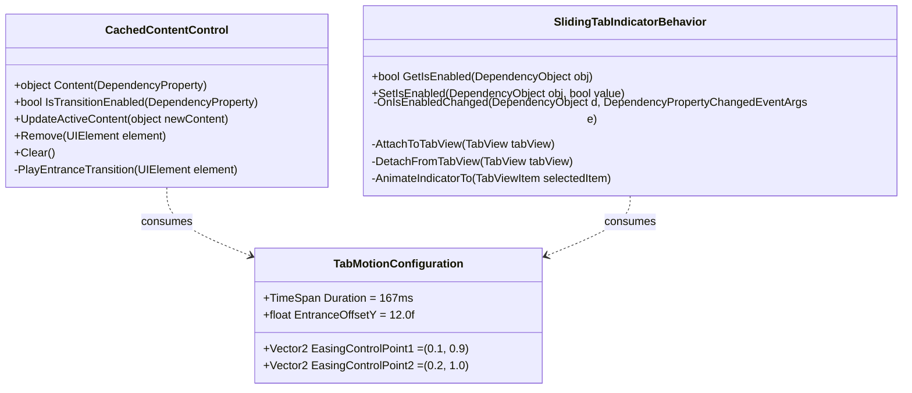

# Phase 1: Data Model & Control Entities

**Feature**: Tab Switching Transition Animations (ShellWindow & DatabasePage)  
**Branch**: `017-tab-transition-animations`  
**Date**: 2026-10-23  

---

## 1. Entities & Control Models

---

## 2. Component Specifications

### 2.1 `CachedContentControl`
- **Location**: `DataSphere/Controls/CachedContentControl.cs`
- **Base Class**: `Microsoft.UI.Xaml.Controls.Grid`
- **Properties**:
  - `Content`: `object?` (DependencyProperty, bound in XAML via `{x:Bind}`)
  - `IsTransitionEnabled`: `bool` (DependencyProperty, default `true`)
- **Key Methods**:
  - `UpdateActiveContent(object? newContent)`: Resolves active UIElement, toggles visibility, triggers compositor entrance transition.
  - `PlayEntranceTransition(UIElement element)`: Dispatches `ScalarKeyFrameAnimation` (opacity 0 → 1) and `Vector3KeyFrameAnimation` (Y translation 12px → 0px) to the element's `Microsoft.UI.Composition.Visual`.

### 2.2 `SlidingTabIndicatorBehavior`
- **Location**: `DataSphere/Controls/SlidingTabIndicatorBehavior.cs`
- **Type**: Static attached behavior class
- **Properties**:
  - `IsEnabledProperty`: Attached `DependencyProperty` on `TabView`
- **Lifecycle & Events**:
  - Hooks `TabView.Loaded`, `TabView.SelectionChanged`, and `TabView.SizeChanged`.
  - Animates the indicator pill's visual position (`Offset.X`) and width (`Size.X`) to align with the active `TabViewItem`.

### 2.3 `TabMotionConfiguration`
- **Location**: `DataSphere/Controls/TabMotionConfiguration.cs`
- **Role**: Centralized motion constants for Windows 11 Fluent Design motion compliance.
- **Values**:
  - `Duration`: 167ms
  - `TranslationOffset`: 12.0f px
  - `CubicBezierControlPoints`: (0.1f, 0.9f) to (0.2f, 1.0f)
