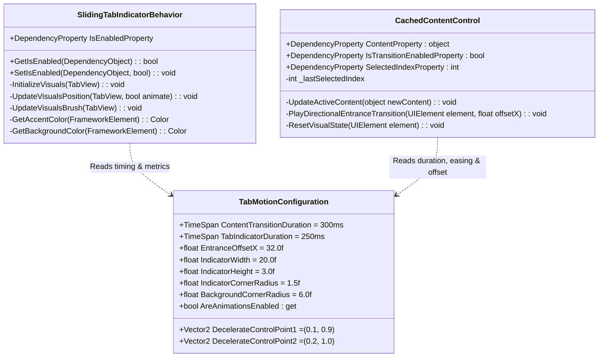

# Data Model & Control Entities: Fluent Tab Selection Pill, Sliding Background & Directional Page Motion

**Feature Branch**: `018-tab-motion-and-indicator`  
**Date**: 2026-10-23  
**Status**: Completed  

---

## 1. Entities & Data Structures



---

## 2. Visual Representation Structures

### 2.1 Tab Header Visual Layers (`SlidingTabIndicatorBehavior`)

```text
TabView (Root ContainerVisual)
├── BackgroundCapsuleVisual (ShapeVisual)
│   ├── Shape: CompositionRoundedRectangleGeometry (Size: TabWidth × TabHeight-4, CornerRadius: 6px)
│   └── Fill: CompositionColorBrush (CardBackgroundFillColorDefaultBrush)
│
├── TabViewItems (XAML visual tree hosting icons, text, close buttons)
│
└── AccentPillVisual (ShapeVisual)
    ├── Shape: CompositionRoundedRectangleGeometry (Size: 20px × 3px, CornerRadius: 1.5px)
    └── Fill: CompositionColorBrush (Windows 11 System Accent Color)
```

### 2.2 Viewport Content Translation Matrix (`CachedContentControl`)

| Navigation Case | Index Comparison | Slide Direction | Entrance Offset | Easing Curve | Duration |
|---|---|---|---|---|---|
| Tab A → Tab B (Right) | `targetIndex > previousIndex` | Right-to-Left | `X: +32.0px → 0.0px` | Decelerate `(0.1, 0.9, 0.2, 1.0)` | 300ms |
| Tab B → Tab A (Left) | `targetIndex < previousIndex` | Left-to-Right | `X: -32.0px → 0.0px` | Decelerate `(0.1, 0.9, 0.2, 1.0)` | 300ms |
| Initial Load / Single Tab | `previousIndex == -1` | Centered / Fade | `X: +32.0px → 0.0px` | Decelerate `(0.1, 0.9, 0.2, 1.0)` | 300ms |
| Reduced Motion Active | OS animations disabled | Instant (<1ms) | `X: 0.0px` | None | 0ms |

---

## 3. Validation Rules

- **R-001 (Color Fidelity)**: The accent color applied to `AccentPillVisual` must update immediately whenever the user changes system accent color or theme in Windows.
- **R-002 (Visual Inset)**: The `AccentPillVisual` width is strictly fixed at 20.0px and height at 3.0px, centered horizontally within the active tab header rectangle.
- **R-003 (Capsule Boundary)**: The `BackgroundCapsuleVisual` must dynamically match the active tab item's exact width and height bounds with a corner radius of 6.0px.
- **R-004 (Directional Accuracy)**: If `newIndex > oldIndex`, translation offset starts at `+32px`. If `newIndex < oldIndex`, translation offset starts at `-32px`.
- **R-005 (Accessibility Override)**: When `TabMotionConfiguration.AreAnimationsEnabled == false`, all animations must be completely skipped, setting final offsets directly.
